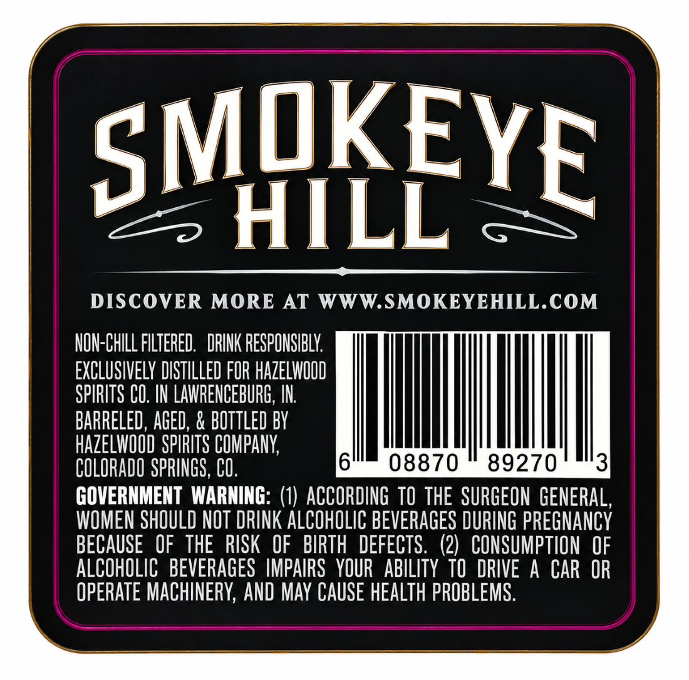
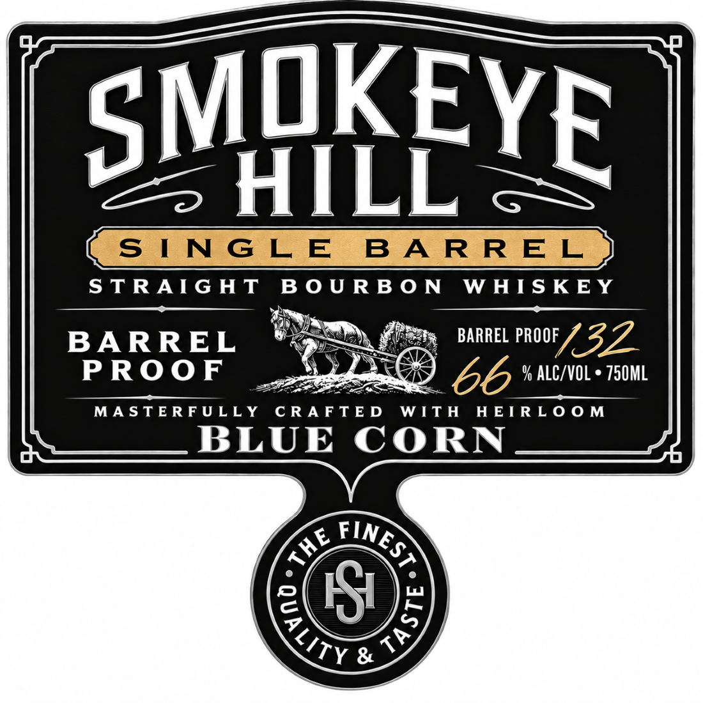
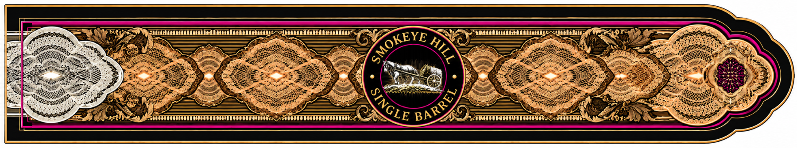

# TTB COLA Label Images - TTBID 26290001000012

**Brand Name:** SMOKEYE HILL

**Issue Date:** 10/21/2026

**Origin Code:** 13

**Product Class/Type:** 101

**Source:** [TTB Public COLA Registry](https://ttbonline.gov/colasonline/viewColaDetails.do?action=publicFormDisplay&ttbid=26290001000012)

## Label Images

### Back Label

### Front Label

### Label 3

## Extracted Label Text

*Text extracted via OCR - may contain errors*

*1 image(s) excluded: text did not meet readability threshold*

### Back Label

SMQKEYE
HILL
DISCOVER MORE AT WWW.SMOKEYEHILL.COM
NON-CHILL FILTERED .  DRINK RESPONSIBLY
EXCLUSIVELY DISTILLED FOR HaZELWQOD
SPIRITS CO. IN LAWRENCEBURG, IN
BARRELED, AGED; & BOTTLED BV
hazeLwOOD SPIRITS COMPANY;
COLORADO SPRINGS, CO.
08870
89270
3
GOVERNMENT  WARNING: (1)  ACCORDING  TO  THE  SURGEON  GENERAL,
WOMEN SHOULD NOT DRINK ALCOHOLIC BEVERAGES DURING PREGNANCY
BECAUSE   OF   THE  RISK   OF   BIRTH  DEFECTS.  (2)   CONSUMPTION OF
ALCOHOLIC   BEVERAGES  IMPAIRS   YOUR   ABILITY  TO   DRIVE A CAR OR
OPERATE MACHINERY; AND MAY CAUSE HEALTH PROBLEMS.

### Front Label

STRAIGHT BOURBON WHISKEY

aie PE eke
MASTERFULLY CRAFTED WITH HEIRLOOM

BLUE CORN
