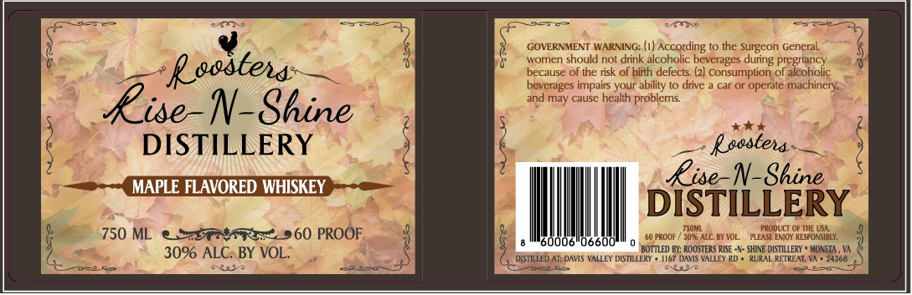

# TTB COLA Label Images - TTBID 26291001000038

**Brand Name:** ROOSTERS RISE -N- SHINE DISTILLERY

**Fanciful Name:** MAPLE FLAVORED WHISKEY

**Issue Date:** 10/21/2026

**Origin Code:** 05

**Product Class/Type:** 149

**Source:** [TTB Public COLA Registry](https://ttbonline.gov/colasonline/viewColaDetails.do?action=publicFormDisplay&ttbid=26291001000038)

## Label Images

### Label 1

## Extracted Label Text

*Text extracted via OCR - may contain errors*

**Detected Proof:** 120

### Label 1

GOVERNMENT WARNING: (1/ _
According
the Surgeon General;
women should not drink alcoholic beverages
pre gnancy
Rsostena:
because of the risk of birth defects (2/ Consumption of alcoholic
bevcrages impairs your ability t0 drive
car or operale
rachinery;
and may causc health problems
RiseN-Shine
DISTILLERY
Rssstena
MAPLE FLAVORED WHISKEY
Rise-N-Shine
DISTILLERY
750m
FRODUCT
THE USL:
750 ML
60 PROOF
PROOF
AlC_ BY VOL
EAjoY RESFONSIBLY:
60006
06600
30% ALC. BY VOL:
BOTTLED BY: RO OSTERS RISE - - SHIVE DISTILLERI
MONETA
DLSTILLED AT: DAVIS VALLEY DISTILLERY
167 DAVIS VALLEY RD
RURAL RETREAT; VA
24368
Nvi
CYoyr
during E
FLEASE
