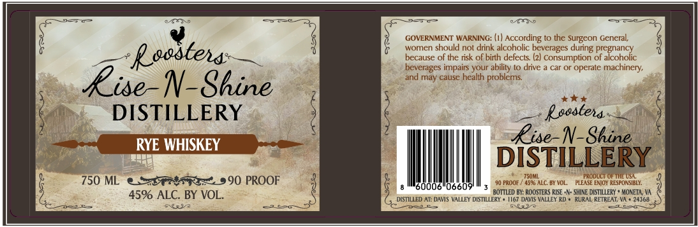

# TTB COLA Label Images - TTBID 26291001000039

**Brand Name:** ROOSTERS RISE -N- SHINE DISTILLERY

**Issue Date:** 10/23/2026

**Origin Code:** 05

**Product Class/Type:** 142

**Source:** [TTB Public COLA Registry](https://ttbonline.gov/colasonline/viewColaDetails.do?action=publicFormDisplay&ttbid=26291001000039)

## Label Images

### Label 1

## Extracted Label Text

*Text extracted via OCR - may contain errors*

**Detected Proof:** 90

### Label 1

GOVERNMENT WARNING: (1| According to the Surgeon General;
Roostea:
8
woren should not drirk alcoholic beverages
pregnancy
because of the risk of birth defects (2
Consumption of alcoholic
bevcrages impairs your ability l0 drive
car or operate
machinery;
Rises
and may cause health
problems
N-Shine
DISTILLERY
Rssstena
Rise-N-Shine
RYE WHISKEY
DISTILLERY
750m
pronuctol
750 ML
590 PROOF
FROOF ,
ALC: BY VOL:
PLEASE EAjOY RESFONSIBLY:
0006
6609
45% ALC. BY VOL.
BOTTLED BI: ROOSTERS RISE -| - SHINE DisTILLERY
MONETA, V
DLSTILLED AT: DAVIS VALLEY DISTILLERY
VALLEY RD
RURAL RETREAT; VA
24368
C8
GL
during
aS
