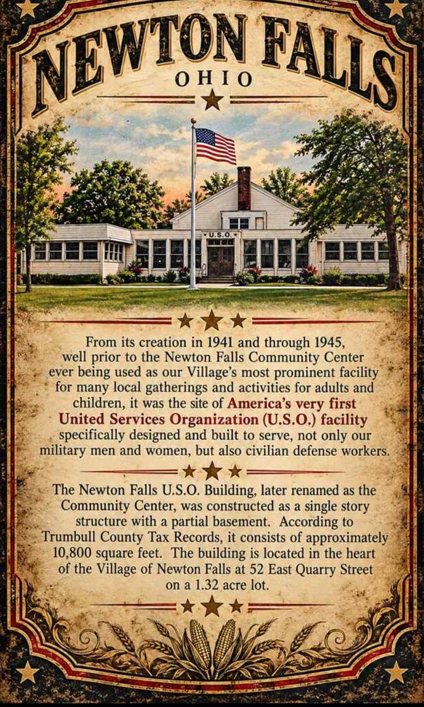
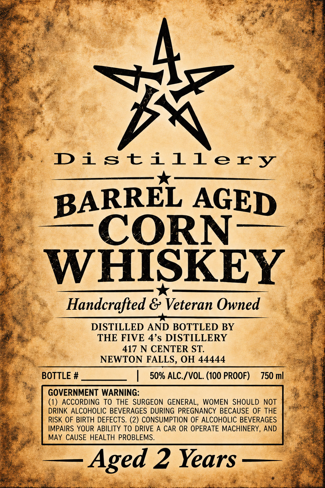

# TTB COLA Label Images - TTBID 26291001000072

**Brand Name:** 44444 DISTILLERY

**Fanciful Name:** BARREL AGED CORN WHISKEY

**Issue Date:** 11/19/2026

**Origin Code:** 09

**Product Class/Type:** 143

**Source:** [TTB Public COLA Registry](https://ttbonline.gov/colasonline/viewColaDetails.do?action=publicFormDisplay&ttbid=26291001000072)

## Label Images

### Back Label

### Front Label

## Extracted Label Text

*Text extracted via OCR - may contain errors*

**Detected Proof:** 100
**Detected Age:** 2 Years

### Back Label

0 H I 0
IUrS.0
From its creation in 1941 and through 1945,
well
to the Newton Falls Community Center
ever
used as our Village'$ most prominent facility
for many local gatherings and activities for adults and
children, it was the site of America'$ very first
United Services Organization (U.S.0.) facility
specifically designed and built to serve, not only our
military men and women, but also civilian defense workers_
The Newton Falls U.S.O. Building, later renamed as the
Community Center; was constructed as a single story
structure with a
partial basement:  According to
Trumbull County Tax Records, it consists of approximately
10,800 square feet.
The building is located in the heart
of the
of Newton Falls at 52 East Quarry Street
on a
1.32 acre lot.
NEWTON
FALLSI
prior
being
Village

### Front Label

7
Di Stillery
BARREL
CORN-
WHISKEY
Handcrafted & Veteran Owned
DISTILLED AND BOTTLED BY
THE FIVE 4's DISTILLERY
417 N CENTER ST:
NEWTON FALLS, OH 44444
BOTTLE #
50% ALC /VOL. (100 PROOF)
750 m
GOVERNMENT WARNING:
(1) ACCORDING TO THE SURGEON GENERAL,
WOMEN SHOULD NOT
DRINK ALCOHOLIC BEVERAGES DURING PREGNANCY BECAUSE OF THE
RISK OF BIRTH DEFECTS. (2) CONSUMPTION OF ALCOHOLIC BEVERAGES
IMPAIRS YOUR ABILITY TO DRIVE
CAR OR OPERATE MACHINERY, AND
MAY CAUSE HEALTH PROBLEMS.
Aged 2 Years
AGED
