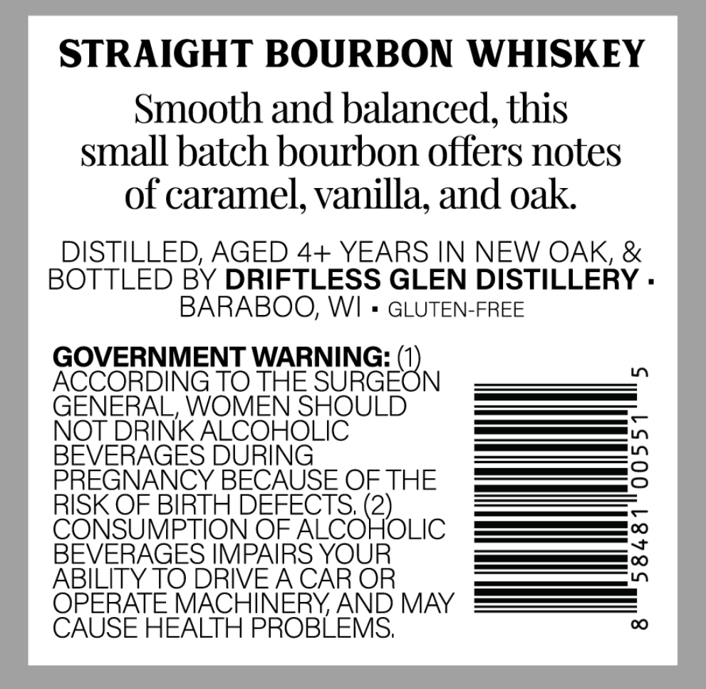
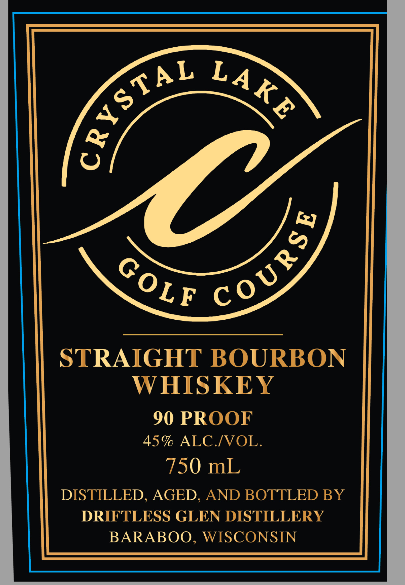

# TTB COLA Label Images - TTBID 26292001000052

**Brand Name:** CRYSTAL LAKE GOLF COURSE

**Issue Date:** 10/21/2026

**Origin Code:** 48

**Product Class/Type:** 101

**Source:** [TTB Public COLA Registry](https://ttbonline.gov/colasonline/viewColaDetails.do?action=publicFormDisplay&ttbid=26292001000052)

## Label Images

### Back Label

### Front Label

## Extracted Label Text

*Text extracted via OCR - may contain errors*

**Detected Proof:** 90

### Back Label

STRAIGHT BOURBON WHISKEY
Smooth and balanced, this
small batch bourbon offers notes
of caramel, vanilla; and oak
DISTILLED; AGED 4+ YEARS IN NEW OAK, &
BOTTLED BY DRIFTLESS GLEN DISTILLERY .
BARABOO; WI
GLUTEN-FREE
GOVERNMENT WARNING:
ACCORDING TO THE
SUGEBN
Ln
GENERAL, WOMEN SHOULD
NOT DRINK ALCOHOLIC
BEVERAGES DURING
?
PREGNANCY BECAUSE OF THE
RISK OF BIRTH DEFECTS; (2)
CONSUMPTION OF ALCOHOLIC
BEVERAGES MMPAIRS YOUR
1
ABILITY TO DRIVEA CAR OR
OPERATE MACHINERY AND MAY
CAUSE HEALTH PROBLEMS
0

### Front Label

STRAIGHT BOURBON
WHISKEY
90 PROOF
45% ALC IVOL.
750 mL
DISTILLED, AGED, AND BOTTLED BY
DRIFTLESS GLEN DISTILLERY
BARABOO,
WISCONSIN
GRystA}
LAKE
Q Co3S
