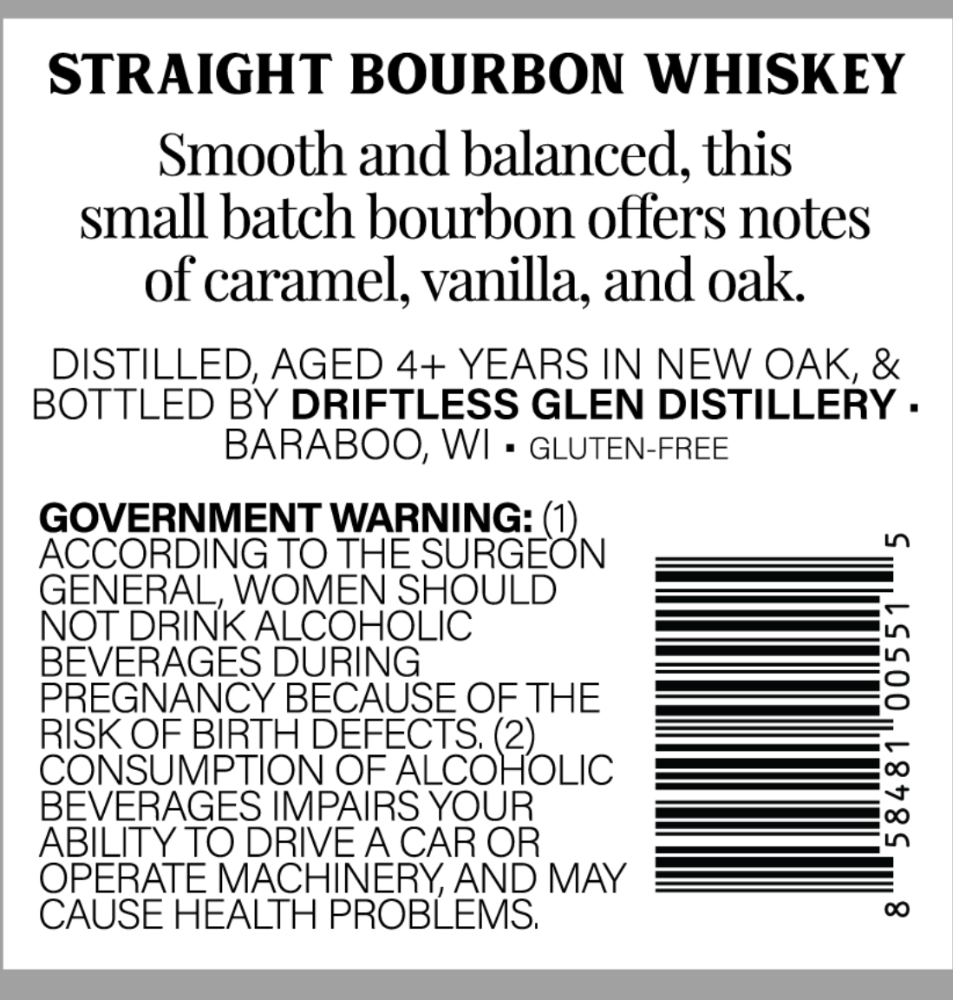
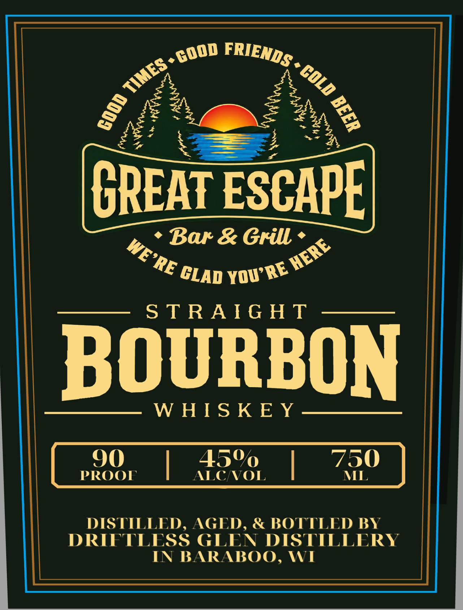

# TTB COLA Label Images - TTBID 26292001000054

**Brand Name:** GREAT ESCAPE

**Issue Date:** 10/23/2026

**Origin Code:** 48

**Product Class/Type:** 101

**Source:** [TTB Public COLA Registry](https://ttbonline.gov/colasonline/viewColaDetails.do?action=publicFormDisplay&ttbid=26292001000054)

## Label Images

### Back Label

### Front Label

## Extracted Label Text

*Text extracted via OCR - may contain errors*

**Detected Proof:** 90

### Back Label

STRAIGHT BOURBON WHISKEY
Smooth and balanced, this
small batch bourbon offers notes
of caramel, vanilla; and oak
DISTILLED, AGED 4+ YEARS IN NEW OAK, &
BOTTLED BY DRIFTLESS GLEN DISTILLERY .
BARABOO; WI
GLUTEN-FREE
GOVERNMENT WARNING:
ACCORDING TO THE
'SURGEON
0
GENERAL, WOMEN SHOULD
NOT DRINK ALCOHOLIC
BEVERAGES DURING
3
PREGNANCY BECAUSE OF THE
RISK OF BIRTH DEFECTS; (2)
CONSUMPTION OF ALCOHOLIC
BEVERAGES IMPAIRS YOUR
1
ABILITY TO DRIVEACAR OR
OPERATE MACHINERYAND MAY
CAUSE HEALTH PROBLEMS;
0

### Front Label

2
CREAT ESCAPE
Bar & Grill
S TRAIG H T
BOURBON
W HIS KE Y .
90
45%
750
PROOF
ALCNVOL
ML
DISTILLED , AGED ,
BOTTLED BY
DRIFTLESS GLEN DISTILLERY
IN BARABOO, WI
FRIENDS_
GOOD
TIMES .
COLD
8
1

4
HERE
WE'RE
YOU RE
GLAD
