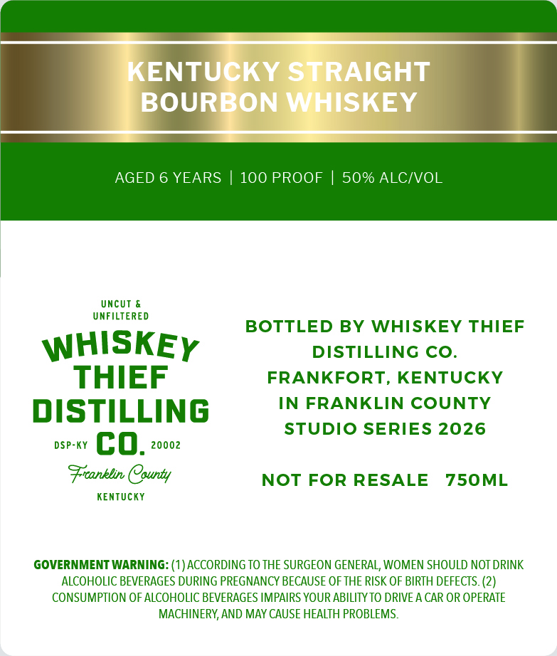
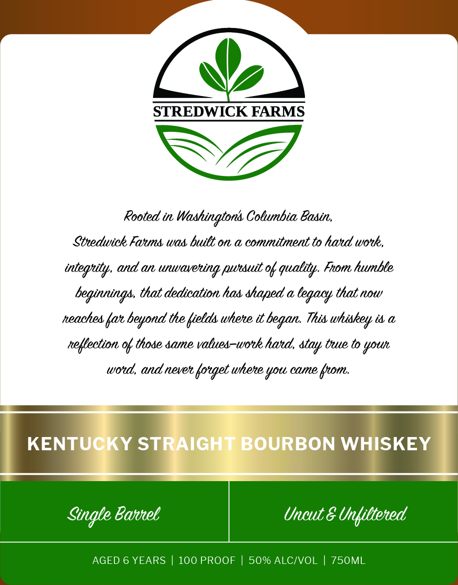

# TTB COLA Label Images - TTBID 26292001000065

**Brand Name:** WHISKEY THIEF DISTILLING CO.

**Issue Date:** 10/21/2026

**Origin Code:** 22

**Product Class/Type:** 101

**Source:** [TTB Public COLA Registry](https://ttbonline.gov/colasonline/viewColaDetails.do?action=publicFormDisplay&ttbid=26292001000065)

## Label Images

### Back Label

### Front Label

## Extracted Label Text

*Text extracted via OCR - may contain errors*

**Detected Proof:** 100
**Detected Age:** 6 Years

### Back Label

KENTUCKY STRAIGHT
BOURBON WHISKEY
AGED
6 YEARS
100 PROOF
50% ALCIVOL
Uncut &
UNFILTERED
BOTTLED BY WHISKEY THIEF
WHISKEY
DISTILLING CO_
THIEF
FRANKFORT, KENTUCKY
DISTILLING
IN FRANKLIN COUNTY
STUDIO SERIES 2026
DSP-KY
co_
20002
Frronblin County
NOT FOR RESALE
750ML
KEnTUcKY
GOVERNMENT WARNING: (1)ACCORDING TO THE SURGEON GENERAL, WOMEN SHOULD NOT DRINK
ALCOHOLIC BEVERAGES DURING PREGNANCY BECAUSE OFTHE RISK OF BIRTH DEFECTS. (2)
CONSUMPTION OF ALCOHOLIC BEVERAGES IMPAIRS YOUR ABILITYTO DRIVE A CAR OR OPERATE
MACHINERY,AND MAY CAUSE HEALTH PROBLEMS.

### Front Label

LT

W,

STREDWICK FARMS

A,

Rooted in Washington’ Columbia Basin,

Stredwick Fauns was built on a commitment to hard work,
integrity, and an unwavering pursuit of quality. From humble
beginnings, that dedication has shaped a legacy that now
reaches far beyond the fields where tt began. This whiskey ts a
reflection of those same values-work hard, stay tuve to your

Single Gavel neut & Unfiltered
