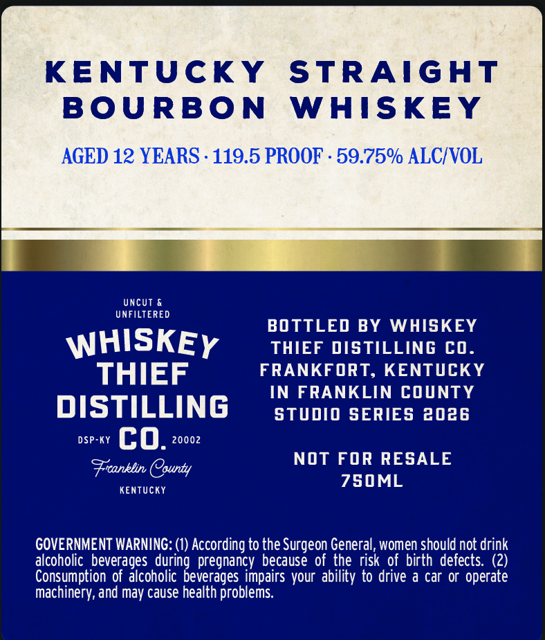
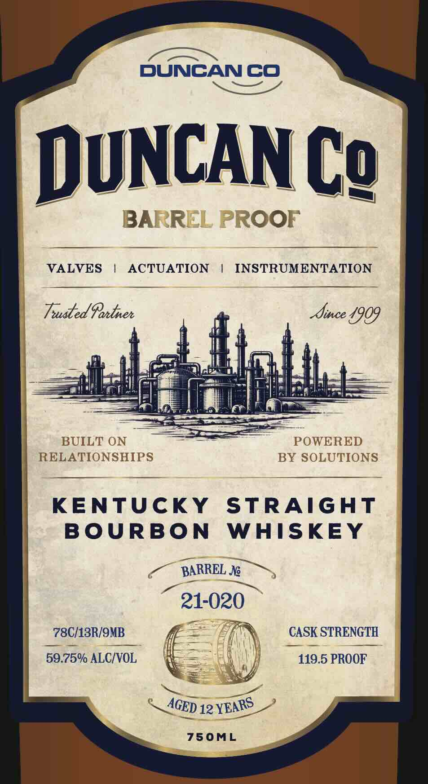

# TTB COLA Label Images - TTBID 26292001000073

**Brand Name:** WHISKEY THIEF DISTILLING CO.

**Issue Date:** 10/21/2026

**Origin Code:** 22

**Product Class/Type:** 101

**Source:** [TTB Public COLA Registry](https://ttbonline.gov/colasonline/viewColaDetails.do?action=publicFormDisplay&ttbid=26292001000073)

## Label Images

### Back Label

### Front Label

## Extracted Label Text

*Text extracted via OCR - may contain errors*

**Detected Proof:** 119.5
**Detected Age:** 12 Years

### Back Label

KENTUCKY
STRAIGHT
BOURBON
WAISKEY
AGED 12 YEARS . 119.5 PROOF
59.75% ALCIVOL
UncUt &
UNFILTERED
BOTTLED BY
WHISKEY
WHISKEY
THIEF DISTILLING CO.
THIEF
FRANKFORT, KENTCKY
IN FRANKLIN COUNTY
DISTILLING
stDiO SERIES 2026
DSP-KY
co.
20002
Frcanklin County
NOT FOR RESALE
KenTUucky
750ML
GOVERNMENT WARNING: (1) According to the Surgeon General, women should not drink
alcoholic  beverages
pregnancy because of the risk of birth defects: (2)
Consumption of alcoholic
impairs your ability to drive a car 0r operate
machinery, and may cause health problems:
norideveegges

### Front Label

DUNCAN CO
DUNCAN Cg
BARREL PROOF
VALVES
ACTUATION
INSTRUMENTATION
TutedGontnen
Xince 4909
BUILT ON
POWERED
RELATIONSHIPS
BY SOLUTIONS
KENTUCKY
STRAIGHT
BOURBON
WHISKEY
BARREL N
21-020
78C/13R/9MB
CASK STRENGTH
59.75% ALCIVOL
119.5 PROOF
12
750ML
YEARS
AGED
