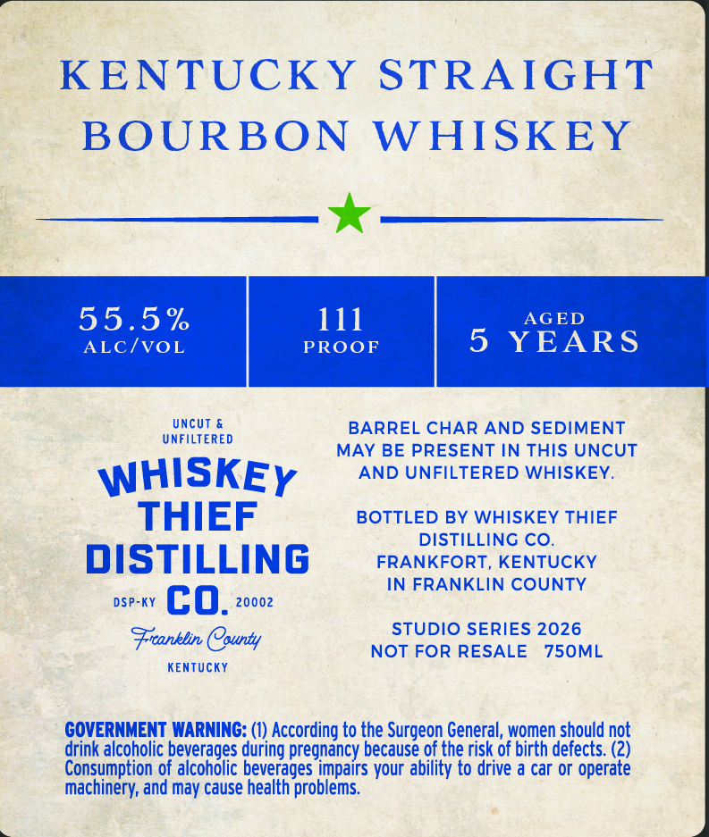
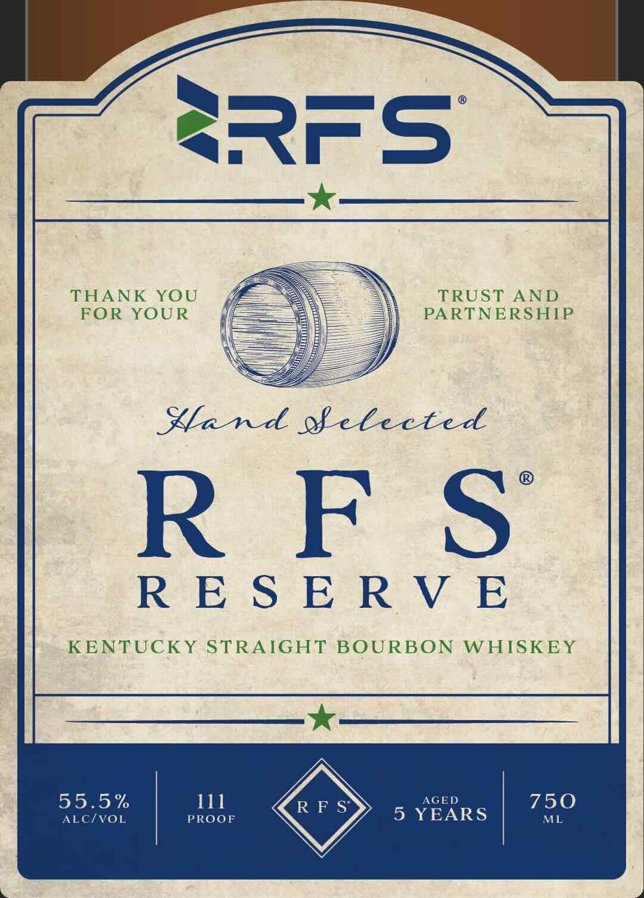

# TTB COLA Label Images - TTBID 26292001000077

**Brand Name:** WHISKEY THIEF DISTILLING CO.

**Issue Date:** 10/21/2026

**Origin Code:** 22

**Product Class/Type:** 101

**Source:** [TTB Public COLA Registry](https://ttbonline.gov/colasonline/viewColaDetails.do?action=publicFormDisplay&ttbid=26292001000077)

## Label Images

### Back Label

### Front Label

## Extracted Label Text

*Text extracted via OCR - may contain errors*

**Detected Proof:** 111
**Detected Age:** 5 Years

### Back Label

KENTUCKY STRAIGHT
BOURBON
W HISKEY
55.5 %
111
AGED
ALc/VOL
PROOF
5
YEARS
Uncut
BARREL CHAR AND SEDIMENT
UNFILTERED
MAY BE PRESENT IN THIS UNCUT
WHISKEY
AND UNFILTERED WHISKEY_
THIEF
BOTTLED BY WHISKEY THIEF
DISTILLING CO.
DISTILLING
FRANKFORT, KENTUCKY
IN FRANKLIN COUNTY
DSP-KY
co.
20002
STUDIO SERIES 2026
Frranklin County
NOT FOR RESALE
750ML
KEnTUcKY
GOVERNMENT WARNING: (0) According to the Surgeon General, women should not
drink alcoholic beverages during pregnancy because of the risk of birth defects: (2)
Consumption of alcoholic beverages impairs your ability to drive a car or operate
machinery; and may cause health problems.

### Front Label

THANK YOU fF % TRUST AND
FOR YOUR {== PARTNERSHIP

Land ofelected

RFS

RESERVE

KENTUCKY STRAIGHT BOURBON WHISKEY

55.5% 111

ALC/VOL PROOF
