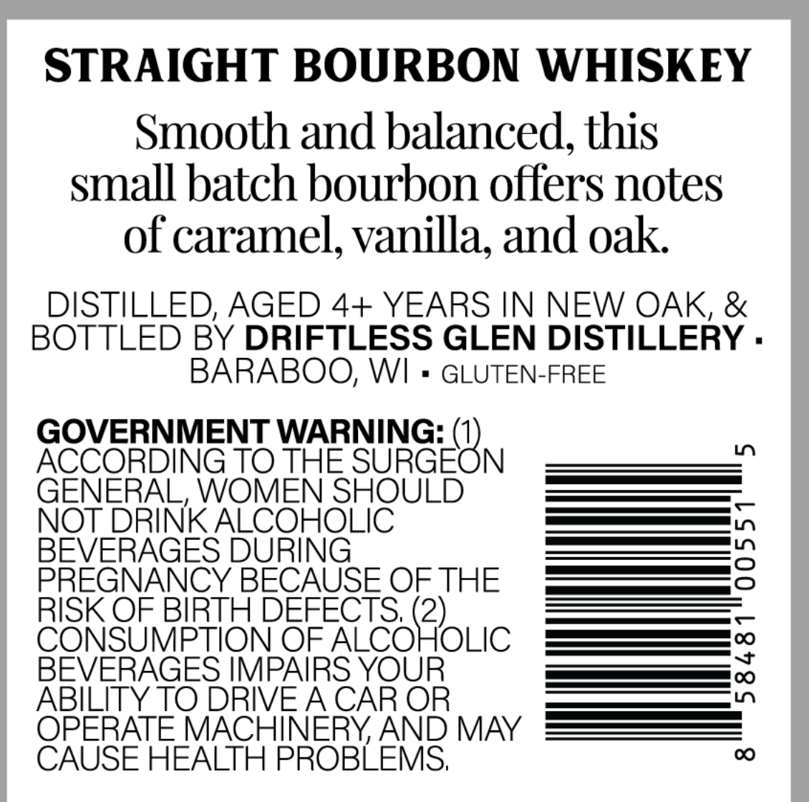
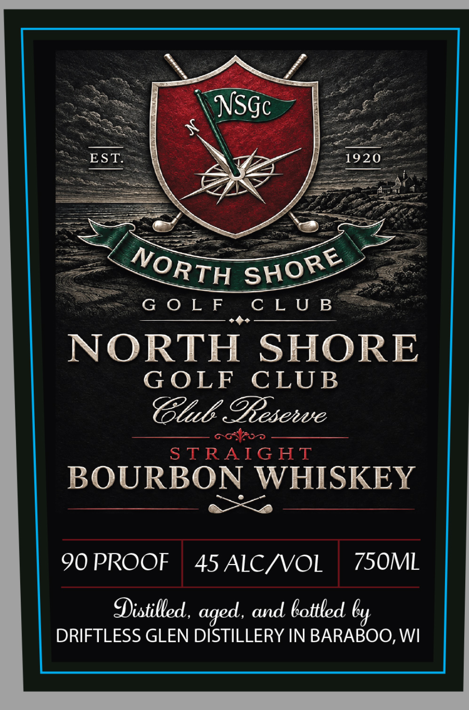

# TTB COLA Label Images - TTBID 26292001000078

**Brand Name:** NORTH SHORE GOLF CLUB

**Issue Date:** 10/22/2026

**Origin Code:** 48

**Product Class/Type:** 101

**Source:** [TTB Public COLA Registry](https://ttbonline.gov/colasonline/viewColaDetails.do?action=publicFormDisplay&ttbid=26292001000078)

## Label Images

### Back Label

### Front Label

## Extracted Label Text

*Text extracted via OCR - may contain errors*

**Detected Proof:** 90

### Back Label

STRAIGHT BOURBON WHISKEY
Smooth and balanced, this
small batch bourbon offers notes
of caramel; vanilla, and oak
DISTILLED, AGED 4+ YEARS IN NEW OAK, &
BOTTLED BY DRIFTLESS GLEN DISTILLERY .
BARABOO, WI
GLUTEN-FREE
GOVERNMENT WARNING: (1)
LO
ACCORDING TO THE SURGEON
GENERAL, WOMEN SHOULD
NOT DRINK ALCOHOLIC
BEVERAGES DURING
2
PREGNANCY BECAUSE OFTHE
RISK OF BIRTH DEFECTS; (2)_
C
CONSUMPTION OF ALCOHOLIC
BEVERAGES IMPAIRS YOUR
:
ABILITY TO DRIVEA CAR OR
OPERATE MACHINERYAND MAY
CAUSE HEALTH PROBLEMS,
0

### Front Label

= GOLF CLUB =
ooo

NORTH SHORE

GOLF CLUB

Clb Fiasewe

Se en

BOURBON WHISKEY
ear ae ea ete ee ee

90 PROOF | 45 ALC/VOL | 750ML

Distilled, aged, and bottled by
DRIFTLESS GLEN DISTILLERY IN BARABOO, WI
