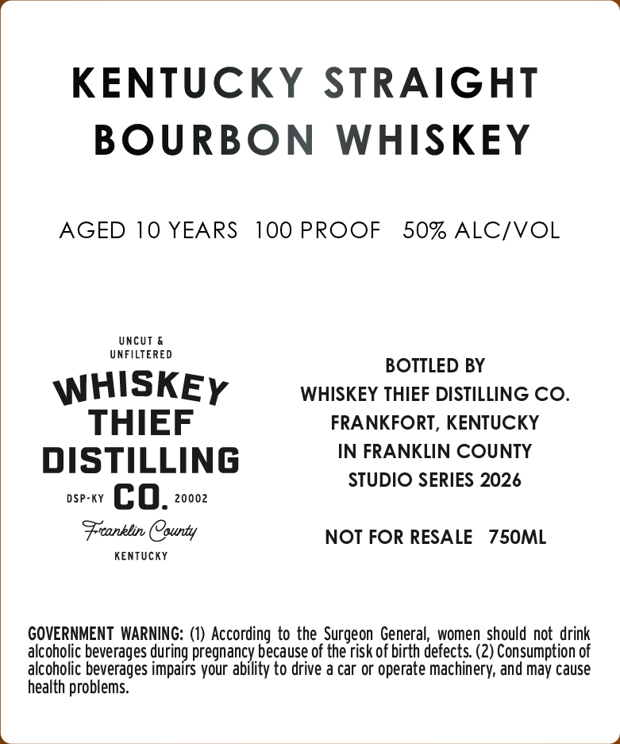
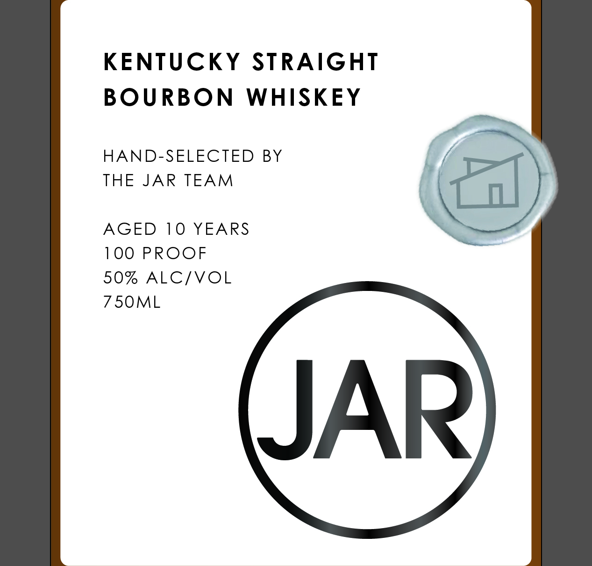
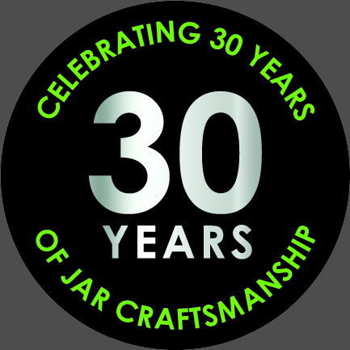
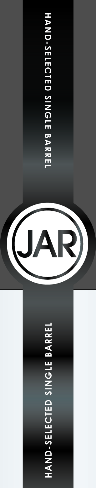

# TTB COLA Label Images - TTBID 26292001000079

**Brand Name:** WHISKEY THIEF DISTILLING CO.

**Issue Date:** 10/22/2026

**Origin Code:** 22

**Product Class/Type:** 101

**Source:** [TTB Public COLA Registry](https://ttbonline.gov/colasonline/viewColaDetails.do?action=publicFormDisplay&ttbid=26292001000079)

## Label Images

### Back Label

### Front Label

### Label 3

### Label 4

## Extracted Label Text

*Text extracted via OCR - may contain errors*

*2 image(s) excluded: text did not meet readability threshold*

**Detected Proof:** 100
**Detected Age:** 10 Years

### Back Label

KENTUCKY STRAIGHT
BOURBON WHISKEY

AGED 10 YEARS 100 PROOF 50% ALC/VOL

UNCUT &
UNFILTERED

BOTTLED BY
WHISKEy WHISKEY THIEF DISTILLING CO.
THIEF FRANKFORT, KENTUCKY
IN FRANKLIN COUNTY
DISTILLING STUDIO SERIES 2026
DSP-KY co. 20002
Franklin County NOT FOR RESALE 750ML

KENTUCKY

GOVERNMENT WARNING: (1) According to the Surgeon General, women should not drink
alcoholic beverages during pregnancy because of the risk of birth defects. (2) Consumption of
alcoholic beverages impairs your ability to drive a car or operate machinery, and may cause
health problems.

### Front Label

KENTUCKY STRAIGHT

BOURBON WHISKEY

HAND-SELECTED BY

THE JAR TEAM

AGED 10 YEARS

100 PROOF

fal

50% ALC/VOL

750ML
