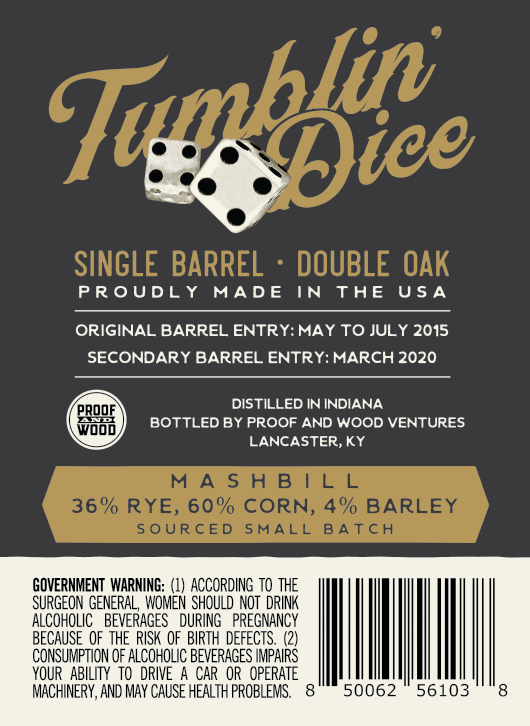
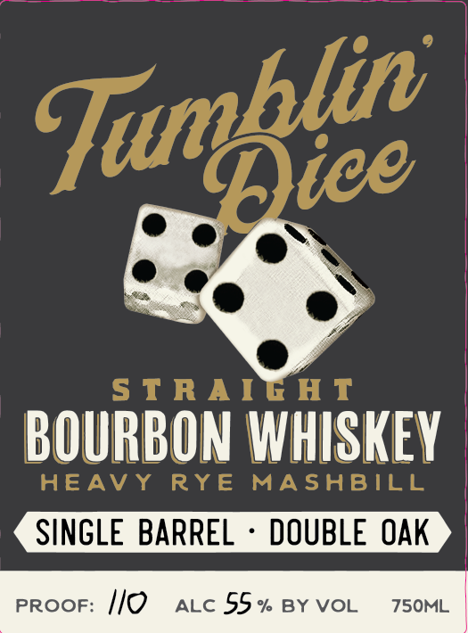

# TTB COLA Label Images - TTBID 26292001000084

**Brand Name:** TUMBLIN DICE

**Issue Date:** 10/21/2026

**Origin Code:** 22

**Product Class/Type:** 101

**Source:** [TTB Public COLA Registry](https://ttbonline.gov/colasonline/viewColaDetails.do?action=publicFormDisplay&ttbid=26292001000084)

## Label Images

### Back Label

### Front Label

## Extracted Label Text

*Text extracted via OCR - may contain errors*

### Back Label

PROUDLY MADE IN THE USA
ORIGINAL BARREL ENTRY: MAY TO JULY 2015
SECONDARY BARREL ENTRY: MARCH 2020
fj eRoor . DISTILLED IN INDIANA
(Giri) BOTTLED BY PROOF AND WOOD VENTURES
4 LANCASTER, KY
GOVERNMENT WARNING: (1) ACCORDING TO THE
SURGEON GENERAL, WOMEN SHOULD NOT DRINK
ALCOHOLIC BEVERAGES DURING PREGNANCY
BECAUSE OF THE RISK OF BIRTH DEFECTS. (2)
CONSUMPTION OF ALCOHOLIC BEVERAGES IMPAIRS,
YOUR ABILITY TO DRIVE A CAR OR OPERATE
MACHINERY, AND MAY CAUSE HEALTH PROBLEMS. 8 50062 56103 8

### Front Label

5 T RA IG HT
BOURBON WHISKEY
HEAVY
RyE
MASABILL
SINGLE BARREL
DOUBLE OAK
PROOF:
Ilo
ALC 55 %
BY VOL
7S0ML
Tumblie
