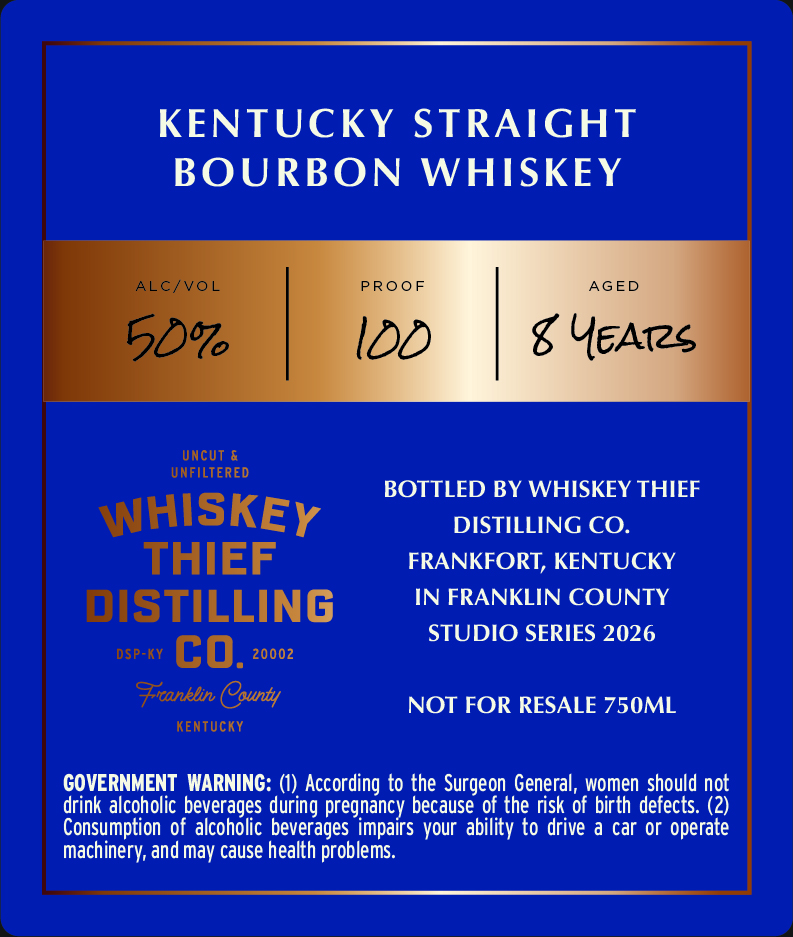

# TTB COLA Label Images - TTBID 26292001000115

**Brand Name:** WHISKEY THIEF DISTILLING CO.

**Issue Date:** 10/21/2026

**Origin Code:** 22

**Product Class/Type:** 101

**Source:** [TTB Public COLA Registry](https://ttbonline.gov/colasonline/viewColaDetails.do?action=publicFormDisplay&ttbid=26292001000115)

## Label Images

### Back Label

### Front Label

### Label 2

## Extracted Label Text

*Text extracted via OCR - may contain errors*

*1 image(s) excluded: text did not meet readability threshold*

### Back Label

KENTUCKY STRAIGHT
BOURBON
WHISKEY
ALC/VOL
PROO F
AGED
50%6
IDD
g YEATs
UncUt
UnFILtEREd
BOTTLED BY WHISKEY THIEF
WHISKEY
DISTILLING CO.
THIEF
FRANKFORT, KENTUCKY
DISTILLING
IN FRANKLIN COUNTY
STUDIO SERIES 2026
DSP-KY
CO.
20002
Ficanklin (Oounty
NOT FOR RESALE 750ML
KenTUcKY
GOVERNMENT  WARNING: (1) According to the Surgeon  General, women should not
drink alcoholic beverages during pregnancy because of the risk of birth defects: (2)
Consumption of alcoholic beverages impairs vour ability to drive a car or operate
machinery; and may cause health problems:

### Front Label

AGED
To
PERFECTION
Telebating
60
Cears
KENTUCKY STRAIGXT BOURBONWHISKEY
'4LC/VOL
509
PROOF
IDD
AGED
g YEATs
750ML
