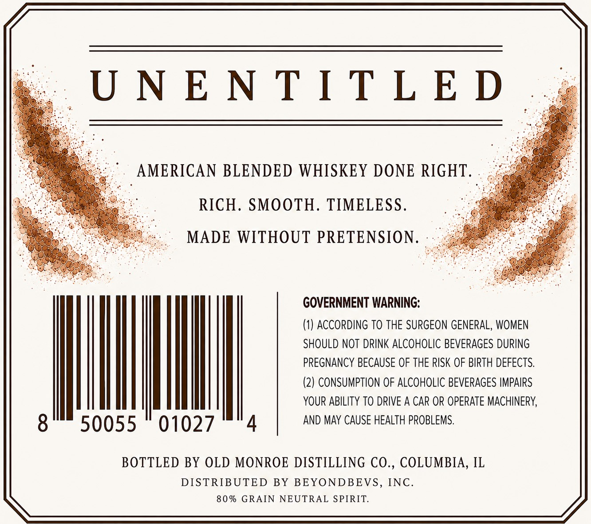
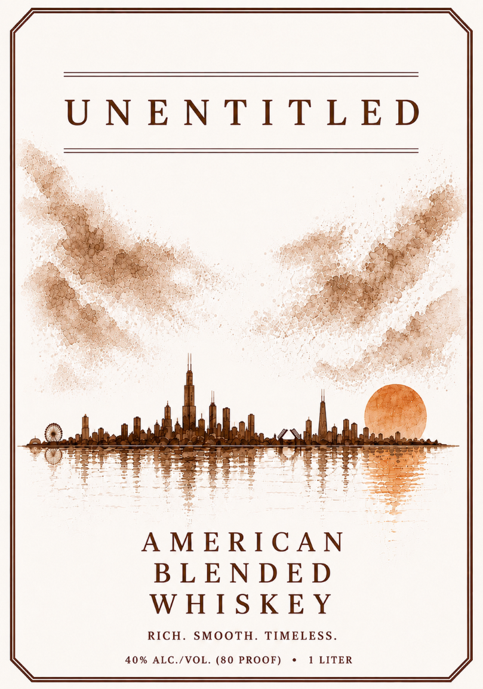

# TTB COLA Label Images - TTBID 26292001000123

**Brand Name:** UNENTITLED

**Fanciful Name:** AMERICAN BLENDED WHISKEY

**Issue Date:** 11/24/2026

**Origin Code:** 04

**Product Class/Type:** 137

**Source:** [TTB Public COLA Registry](https://ttbonline.gov/colasonline/viewColaDetails.do?action=publicFormDisplay&ttbid=26292001000123)

## Label Images

### Back Label

### Front Label

## Extracted Label Text

*Text extracted via OCR - may contain errors*

**Detected Proof:** 80

### Back Label

UNENTITLED

AMERICAN BLENDED WHISKEY DONE RIGHT

RICH. SMOOTH. TIMELESS

MADE WITHOUT PRETENSION

GOVERNMENT WARNING:

(1) ACCORDING TO THE SURGEON GENERAL, WOMEN

SHOULD NOT DRINK ALCOHOLIC BEVERAGES DURING

PREGNANCY BECAUSE OF THE RISK OF BIRTH DEFECTS

(2) CONSUMPTION OF ALCOHOLIC BEVERAGES IMPAIRS

YOUR ABILITY TO DRIVE A CAR OR OPERATE MACHINERY,

|

mM)

50055 — 01027

AND MAY CAUSE HEALTH PROBLEMS.

BOTTLED BY OLD MONROE DISTILLING CO., COLUMBIA, IL

DISTRIBUTED BY BEYONDBEVS, INC

80% GRAIN NEUTRAL SPIRIT.

### Front Label

UNENTITLED

af

&

i

Aran oe

AMERICAN

BLENDED

WHISKEY

RICH. SMOOTH. TIMELESS.

40% ALC./VOL. (80 PROOF)

1 LITER
