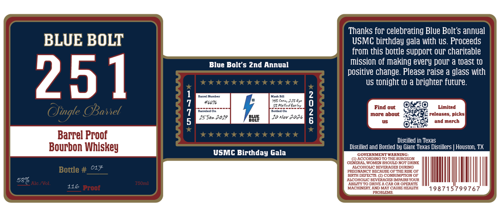

# TTB COLA Label Images - TTBID 26292001000231

**Brand Name:** BLUE BOLT 251

**Issue Date:** 10/23/2026

**Origin Code:** 44

**Product Class/Type:** 101

**Source:** [TTB Public COLA Registry](https://ttbonline.gov/colasonline/viewColaDetails.do?action=publicFormDisplay&ttbid=26292001000231)

## Label Images

### Back Label

## Extracted Label Text

*Text extracted via OCR - may contain errors*

**Detected Proof:** 116

### Back Label

Thanks for celebrating Blue Bolt's annual
BLUE BOLT
USMC birthday gala with US. Proceeds
from this bottle support oUr charitable
Blue Bolt $ 2nd Annual
mission of making every pOur a toast tO
positive change. Please raise a glass With
251
Tttttttttttt
US tonight to a brighter future.
Eenelunukz
HenhDal
46l7l
230
Ofingle Okanet
1
877785
25
1
moind bout
reledieit picks
J5 Jan 4019
Ba1f
10 Nov 2026
and merch
Barrel Proof
Ttttttttttttt
Distilled in Texas
Bourbon Whiskey
Distilled and Bottled by Giant Texas Distillers
Houston; TX
USMC Birthday Gala
GOTERNMTEATTWAKNNG
(IACCORDING TO THE SURGEON
GENERAL FOMEN SHOULD NOT DRINK
017
ACOHOLIC BEVERAGES DURING
Bottle #
PRECNANCY BECAUSE OF THE RISE OF
BIRTH DEFECTS (2) CONSUMPTION OF
587
HCOHOLIC BEVERACES MHPAIRS YOUR
Ale NVol:
780ml
ABILITY TO DRIVE A CAR OR OPERATE
116 Proof
MACHIERY AND MAY CAUSE HEALTH
'198715799767
PROBLEMS
671
