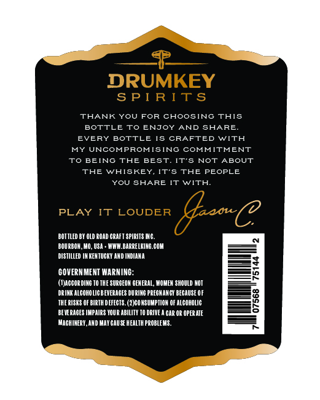
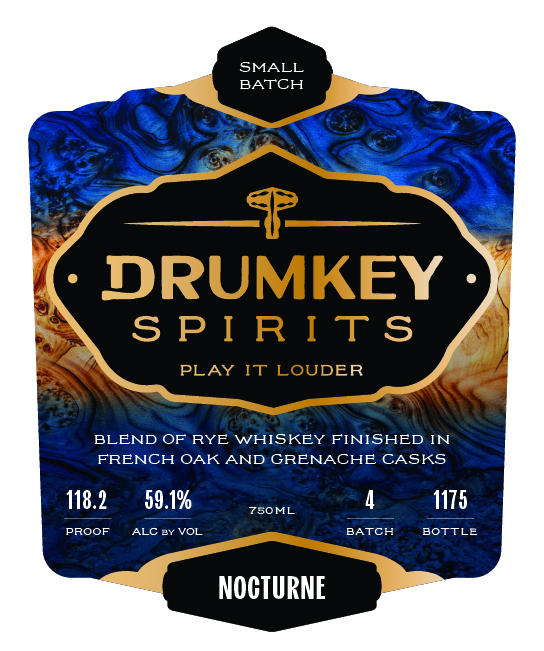

# TTB COLA Label Images - TTBID 26292001000300

**Brand Name:** DRUMKEY SPIRITS

**Issue Date:** 10/28/2026

**Origin Code:** 29

**Product Class/Type:** 122

**Source:** [TTB Public COLA Registry](https://ttbonline.gov/colasonline/viewColaDetails.do?action=publicFormDisplay&ttbid=26292001000300)

## Label Images

### Back Label

### Front Label

## Extracted Label Text

*Text extracted via OCR - may contain errors*

**Detected Proof:** 118.2

### Back Label

DRUMKEY
S P I RITs
TAANK YOU FOR CHOOSING
ThIS
BOTTLE
To
ENJOY
AND SHARE;
EVERY
BOTTLE 18
CRAFTED
WITh
MY UNCOMPROMISING COMMITMENT
To BEING
TAE
BEST
ITs Not
ABOUT
THE
WAISKEY,ITs THE PEOPLE
YOU SHARE ITWITH
PLAY IT
LOUDER
{azoC
BOT TLED BY OLD ROAD CRAF ] SPIRITS NC.
BOURBOH , MO , USA
WWM BaRRE LKIMO.COM
distiLLed IM KEM TUCKT AMd IMdIAMA
GOVERNMENT WARNING:
(IjacCOR DIMd `
THE SUROEOH BEMeRAL
DRIMK /
COHOLICE
everade$ DURINO [
BECAUSE E
The RISKS OF BIRTH DEFECTS: (21C01
ALCohOLIC
BE VE RaCe$ IMPAIRS HOUR ABILITI `
DRIVE ,
OPER ATE
MACHINERI , AND
healTL

### Front Label

SMALL
BATCH
DRUMKEY
S P I RITs
PLAY IT LOUDER
BLEND
OF
RYE
WHISKEY FINISHED IN
FRENCH
OAK
AND GRENACHE CASKS
118.2
59.1%
1175
7SOML
PROOF
ALC gY VOL
BATCH
BOTTLE
NOCTURNE
