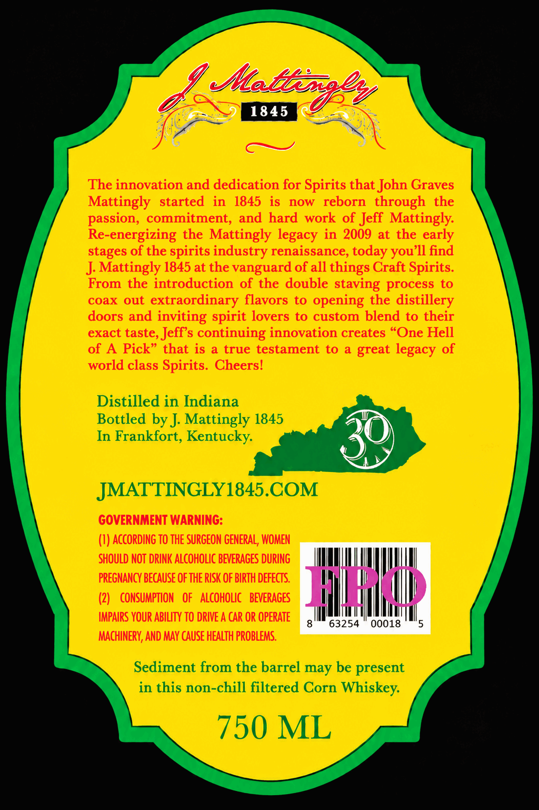
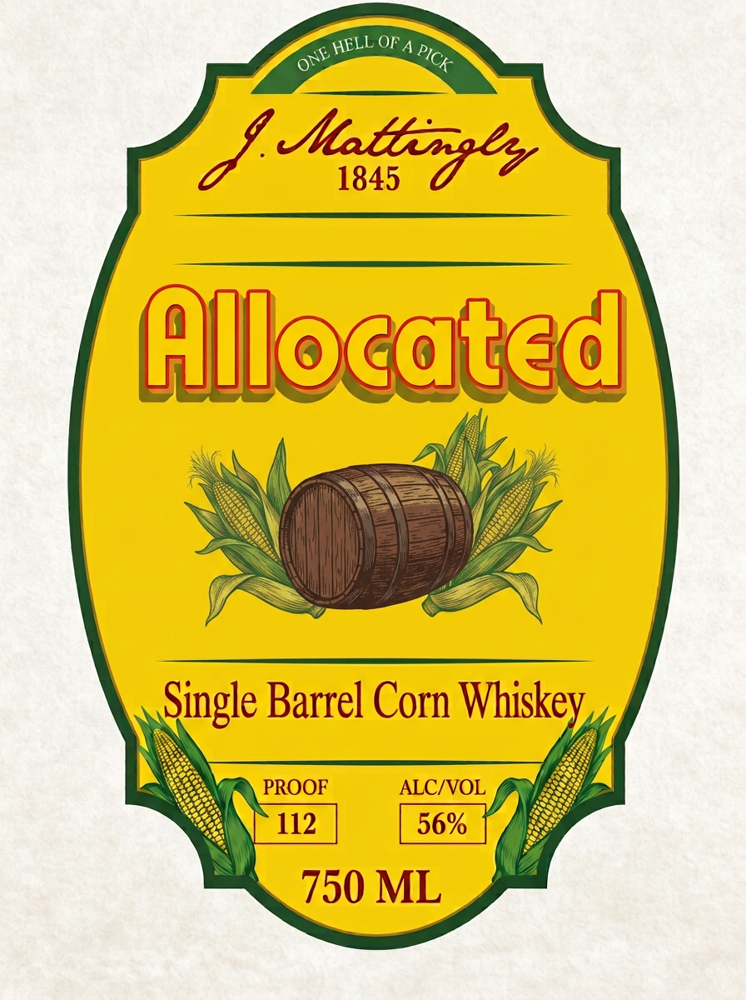
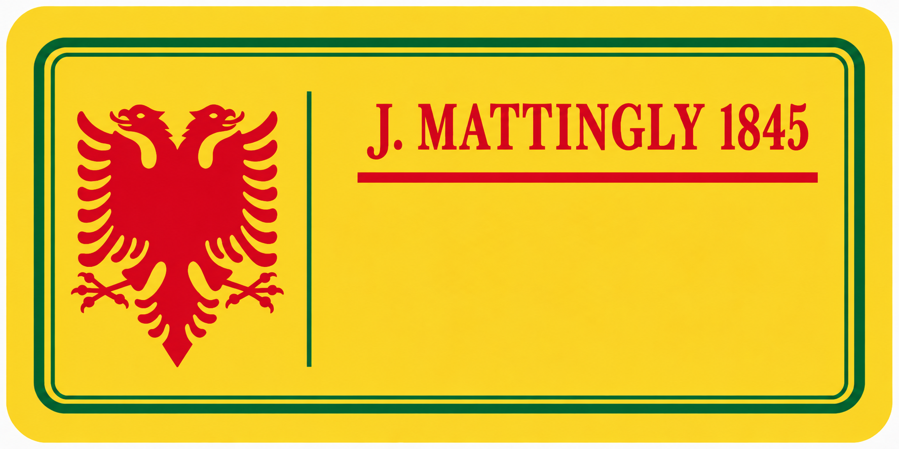

# TTB COLA Label Images - TTBID 26292001000370

**Brand Name:** J. MATTINGLY 1845

**Fanciful Name:** ALLOCATED

**Issue Date:** 10/23/2026

**Origin Code:** 22

**Product Class/Type:** 143

**Source:** [TTB Public COLA Registry](https://ttbonline.gov/colasonline/viewColaDetails.do?action=publicFormDisplay&ttbid=26292001000370)

## Label Images

### Back Label

### Label 1

### Label 3

## Extracted Label Text

*Text extracted via OCR - may contain errors*

*1 image(s) excluded: text did not meet readability threshold*

**Detected Proof:** 112

### Back Label

~Mabbe 84
1845
The innovation and dedication for Spirits that John Graves
Mattingly   started
in  1845 is
now
reborn   through the
passion, commitment; and hard work of Jeff Mattingly:
Re-energizing the Mattingly legacy in 2009 at the early
stages of the spirits industry renaissance,
you ]l find
J Mattingly 1845 at the vanguard of all things Craft Spirits.
From the introduction of the double staving process
to
coax out
extraordinary flavors
to
opening the distillery
doors and
inviting spirit lovers to custom blend to their
exact taste, Jeffs continuing innovation creates "One Hell
of A Pick" that is
true testament to
great legacy of
world class Spirits  Cheers!
Distilled in Indiana
Bottled by J Mattingly 1845
In Frankfort, Kentucky:
JMATTINGLY1845.COM
GOVERNMENT WARNING:
(I) according TO THE SURGEON GENERAL; WOMEN
SHOULD NOT DRINK ALCOHOLIC BEVERAGES DURING
PREGNANCY BECAUSE OF THE RISK OF BIRTH DeFECTS.
(2)
CONSUMPTION   OF   ALcoholic
BEVERAGES
Hhad
IMPAIRS YOUR ABILITY TO DRIVE A CAR OR OPERATE
63254
00018
MAcHINERY, AND MAY CAUSE HEALTh PROBLEMS.
Sediment from the barrel may be present
in this non-chill filtered Corn Whiskey:
750 ML
today -

### Label 1

OF A
Mhabfiea
1845
Allocqted
Single Barrel Corn Whiskey
PROOF
ALCIVOL
112
56%
750 ML
HELL _
PICK
ONE
