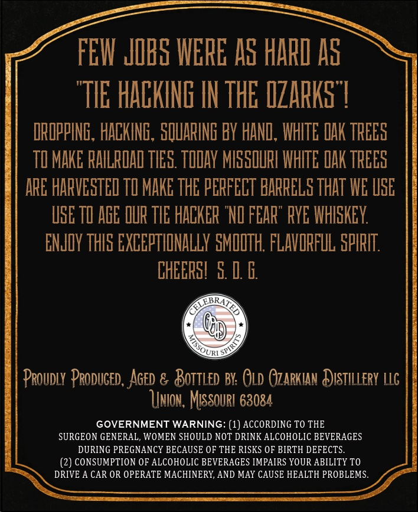
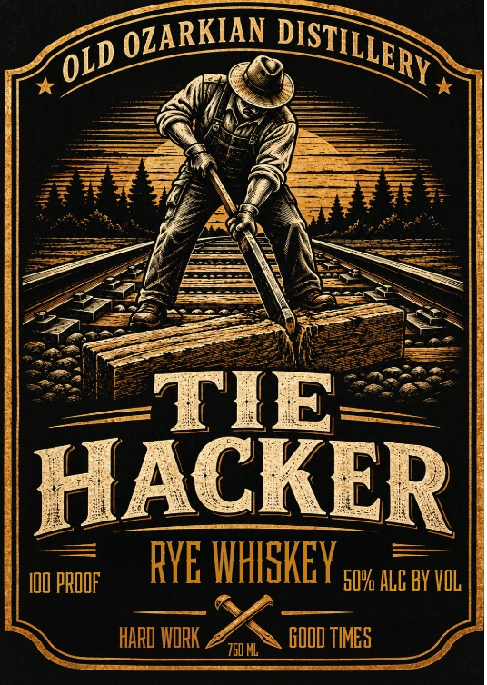

# TTB COLA Label Images - TTBID 26292001000377

**Brand Name:** OLD OZARKIAN DISTILLERY

**Fanciful Name:** TIE HACKER RYE WHISKEY

**Issue Date:** 10/21/2026

**Origin Code:** 29

**Product Class/Type:** 142

**Source:** [TTB Public COLA Registry](https://ttbonline.gov/colasonline/viewColaDetails.do?action=publicFormDisplay&ttbid=26292001000377)

## Label Images

### Back Label

### Front Label

## Extracted Label Text

*Text extracted via OCR - may contain errors*

### Back Label

FET JIRS IERE As HARI AS
"TIE HACKINE IN THE IZARKS 7
DROPPING, HACKING , SQUARING Y HANL , WHITE QAK TREES
TI MAKE RAILROAL TIES TODAY MISSOURL IHITE DAK TREES
ARE HARVESTEL TO MAKE THE PERFECT BARRELS ThAT WE VSE
UGE TL AGE OUR TLE HACKER "NI FEAR" RYE WHISKEY
ENJOY THIS EXCEPTHONALLY SMODTH; FLAVORFLL SPIRIT
CHEERSL 5 [ 6
URI
Proudly Produced , Aged & Boitled BY: Old Ozarkuan Distiliery LLG
UUnIon, MISSOuRI 63084
GOVERNMENT WARNING: (1) ACCORDING TO THE
SURGEON GENERAL, WOMEN SHOULD NOT DRINK ALCOHOLIC BEVERAGES
DURING PREGNANCY BECAUSE OF THE RISKS OF BIRTH DEFECTS
CONSUMPTION OF ALCOHOLIC BEVERAGES IMPAIRS YOUR ABILITY TO
DRIVE A CAR OR OPERATE MACHINERY, AND MAY CAUSE HEALTH PROBLEMS.

### Front Label

TIE
HACKER
IDD PROOF
FVE IHISKEY 5uk alE by vul |
HARD IORK
750 ML
GDOD TIMES
OZARKIAN
DISTILLERY
OLD
