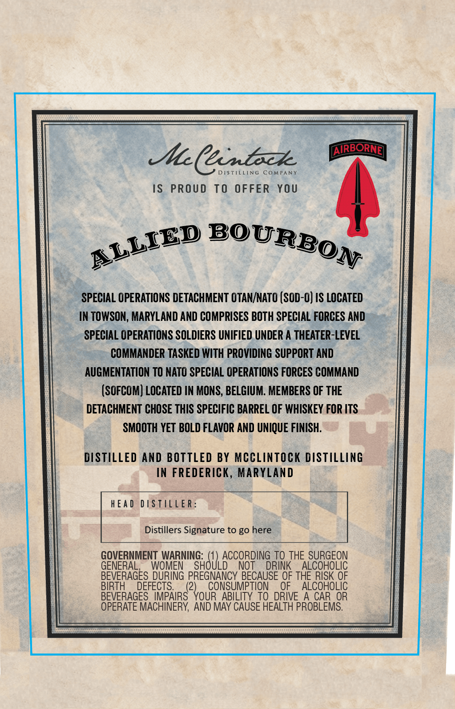
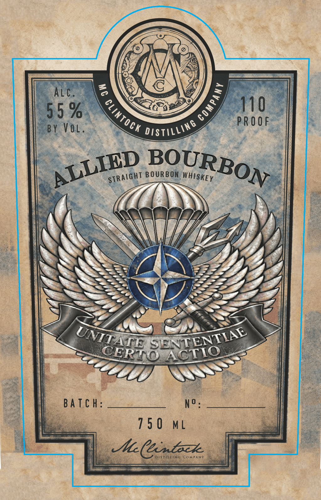
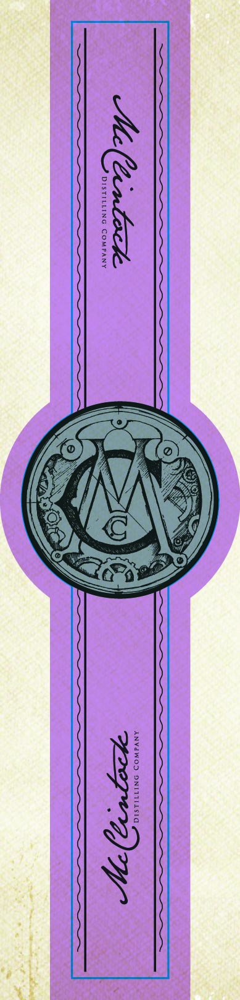

# TTB COLA Label Images - TTBID 26292001000388

**Brand Name:** ALLIED BOURBON

**Issue Date:** 10/26/2026

**Origin Code:** 25

**Product Class/Type:** 101

**Source:** [TTB Public COLA Registry](https://ttbonline.gov/colasonline/viewColaDetails.do?action=publicFormDisplay&ttbid=26292001000388)

## Label Images

### Back Label

### Label 1

### Label 3

## Extracted Label Text

*Text extracted via OCR - may contain errors*

*1 image(s) excluded: text did not meet readability threshold*

**Detected Proof:** 110

### Back Label

ICenbzk
AIRBORNE]
DISTILLING
CoMPANY
IS PROUD
TO OFFER
YOU
SPECIAL OPERATIONS DETACHMENT OTAN/NATO (SOD-0) IS LOCATED
IN TOWSON, MARYLAND AND COMPRISES BOTH SPECIAL FORCES AND
SPECIAL OPERATIONS SOLDIERS UNIFIED UNDER A THEATER-LEVEL
COMMANDER TASKED WITH PROVIDING SUPPORT AND
AUGMENTATION TO NATO SPECIAL OPERATIONS FORCES COMMAND
(SOFCOM) LOCATED IN MONS, BELGIUM: MEMBERS OF THE
DETACHMENT CHOSE THIS SPECIFIC BARREL OF WHISKEY FOR ITS
SMOOTH YET BOLD FLAVOR AND UNIQUE FINISH.
DISTILLED AND BOTTLED BY MccLiNTOCK DISTILLING
IN FREDERICK, MARYLAND
HEA d
DSTIleR
Distillers Signature to go here
GOVERNMENT WARNING:
ACCORDING TO THE SURGEON
GENERAL
WOMEN
"SHULBc
NOT
DRINK
ALCOHOLIC
BEVERAGES_DURING PREGNANCY BECAUSE OF THE RISK 0F
BIRTH
DEFECTS.
CONSUMPTION
OF
ALCOHOLIC
BEVERAGES IMPAIRS
2vouo
ABILITY TO DRIVE
A CAR OR
OPERATE MACHINERY, AND MAY CAUSE HEALTH PROBLEMS.
BOURBON
ALLIED

### Label 1

2
Alc.
0
5 5 %
110
PROOF
BY Vol.
BOURBON
Ba Tc h:
No _
1 5 0
M
ICenbzk
DISTILLING
CoMPANY
1
clintock
distilLinG
BOURBON
ALLIED
StRAiGhT
WHISkEy
UNITATE
SEENTENTIAE
CERTO
ACTIO
