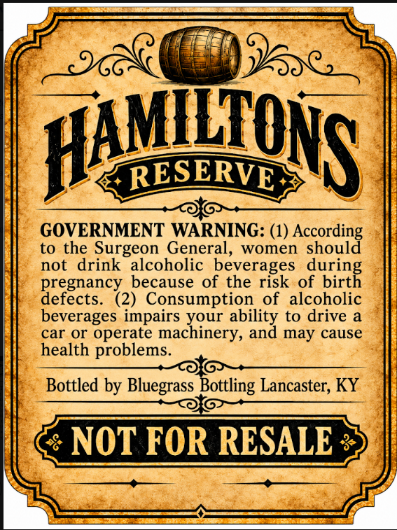
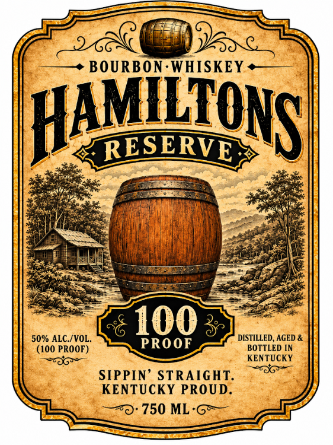
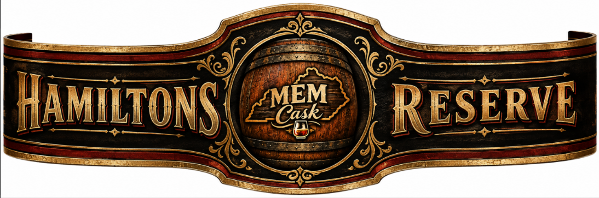

# TTB COLA Label Images - TTBID 26292001000425

**Brand Name:** HAMILTONS RESERVE

**Issue Date:** 11/12/2026

**Origin Code:** 22

**Product Class/Type:** 141

**Source:** [TTB Public COLA Registry](https://ttbonline.gov/colasonline/viewColaDetails.do?action=publicFormDisplay&ttbid=26292001000425)

## Label Images

### Back Label

### Front Label

### Label 3

## Extracted Label Text

*Text extracted via OCR - may contain errors*

*1 image(s) excluded: text did not meet readability threshold*

### Back Label

HAVTQKS
RESERVE
GOVERNMENT WARNING: (1)
AAccoodir
to the Surgeon General,
women
not
drink
alcoholic beverages during
because
of the risk of birth
Retecasacy
(2) Consumption of
alcoholic
beverages impairs your ability to drive
car or
operate machinery, and may cause
health problems_
cot
Bottled by Bluegrass Bottling Lancaster; KY
4
NOT FOR RESALE

### Front Label

= ACPI
——+ BOURBON: WHISKEY -——
HP RESERVE NG
Ain i Oo
cue ee) Beret
ahead Ne) Bae
tee PROOF iets
IG KENTUCKY
SIPPIN’ STRAIGHT. ame
KENTUCKY PROUD.
<9: 750 ML-G=— ]
