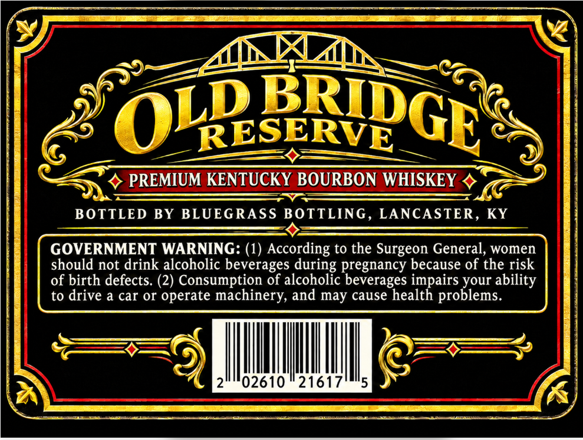

# TTB COLA Label Images - TTBID 26292001000431

**Brand Name:** OLD BRIDGE RESERVE

**Issue Date:** 11/17/2026

**Origin Code:** 22

**Product Class/Type:** 141

**Source:** [TTB Public COLA Registry](https://ttbonline.gov/colasonline/viewColaDetails.do?action=publicFormDisplay&ttbid=26292001000431)

## Label Images

### Back Label

## Extracted Label Text

*Text extracted via OCR - may contain errors*

### Back Label

RESERVE
PREMIUM KENTUCKY BOURBON WHISKEY
BOTTLED BY BLUEGRASS BOTTLING, LANCASTER, KY
GOVERNMENT WARNING: (1) According to the Surgeon General, women
should not drink alcoholic beverages during pregnancy because of the risk
of birth defects (2) Consumption of alcoholic beverages impairs your ability
to drive a car Or operate machinery, and may cause health problems
02610
21617
5
BRIDGE
OLR
