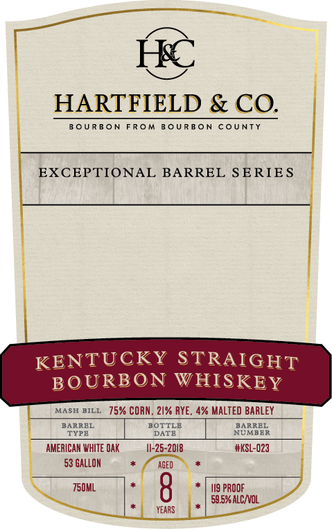
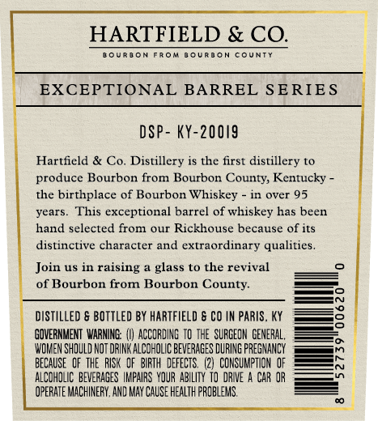

# TTB COLA Label Images - TTBID 26292001000469

**Brand Name:** HARTFIELD & CO

**Fanciful Name:** EXCEPTIONAL BARREL

**Issue Date:** 10/26/2026

**Origin Code:** 22

**Product Class/Type:** 101

**Source:** [TTB Public COLA Registry](https://ttbonline.gov/colasonline/viewColaDetails.do?action=publicFormDisplay&ttbid=26292001000469)

## Label Images

### Front Label

### Label 2

## Extracted Label Text

*Text extracted via OCR - may contain errors*

**Detected Proof:** 119

### Front Label

HARTFIELD & CO.
8 OUR BO N FRom B0URBON CoUNTY
EXCEPTIONAL BARREL SERIE S
KENTUCKY STRAIGHT
BOURBON WHISKEY
MASH BILL
75% CORN , 21% RYE , 4% MALTED BARLEY
BARREL
BOTTLE
BARREL
TYPE
DATE
NUMBER
AMERICAN WHITE OAK
I1-25-2018
#KSL-023
53 GALLON
AGED
Z50ML
8
II9 PROOF
59.5% ALCNOL
yeaRS

### Label 2

HARTFIELD & CO.
BOURJoN
From
J6URBCN
CountT
EXCEPTIONAL BARREL SERIES
DSP - KY-20019
Hartficld & Co Distillery is the first distillery t0
produce Bourbon from Bourbon County; Kentucky
the birthplace of Bourbon Whiskey
in over 95
years_
This exceptional barrel of whiskey has been
hand selected from our Rickhouse because of its
distinctive character and extraordinary qualities_
Join us in raising
glass to the revival
of Bourbon from Bourbon County
DISTILLED & BOTTLED BY
HARTFIELD & CO IN PARIS. KY
GOVERNMENT WARNINE:
ACCORDING TO THE  SUFGEON CENERAL,
WOMEN SHDULD NOT DRINK
COHOLIC BFVERAGES DURING PRESNAMCY
BECAUSE  QF THE  RISK   OF   BIRTH  DEFECTS  (2)  CONSUMPTION  _F
ALCOHDLIC  BEVERAGES IFAIRS  YOUR  ABILITY  TO DRNE
ChR _R
OPERATE MACHINEFY, AMD MAY CAUSE Health PROBLEMS
