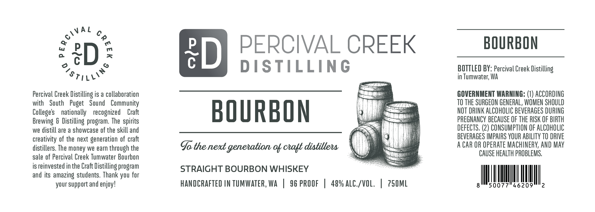

# TTB COLA Label Images - TTBID 26292001000510

**Brand Name:** PERCIVAL CREEK DISTILLING

**Issue Date:** 11/06/2026

**Origin Code:** 07

**Product Class/Type:** 101

**Source:** [TTB Public COLA Registry](https://ttbonline.gov/colasonline/viewColaDetails.do?action=publicFormDisplay&ttbid=26292001000510)

## Label Images

### Label 1

## Extracted Label Text

*Text extracted via OCR - may contain errors*

**Detected Proof:** 96

### Label 1

A L
0
eD
ED
PERCIVAL CREEK
BOURBON
0
DISTILLING
BOTTLED BY: Percival Creek Distilling
in Tumwater; WA
Percival Creek Distilling is a collaboration
GOVERNMENT WARNING: (1) ACCORDING
with
South
Puget
Sound   Community
TO THE SURGEON GENERAL, WOMEN SHOULD
Colleges
nationally   recognized
Craft
BOURBON
NOT DRINK ALCOHOLIC BevERAGES DURING
Brewing & Distilling  program. The
PREGNANCY beCAuSE OF THE RISK OF BIRTH
we distill are a showcase of the skill and
DEFECTS, (2) CONSUMPTION €F ALCOHOLIC
creativity of the next generation of craft
BEVERAGES IMPAIRS YOUR AbILITY TO DRIVE
distillers. The money we earn through the
G the next genenation ok calt distillehs
A CAR OR Operate MachinERV; AND May
sale of Percival Creek Tumwater Bourbon
CAUSE HEALTH PROBLEMS;
is reinvested in the Craft Distilling program
STRAIGHT BOURBON WHISKEY
and its amazing students. Thank you for
your support and enjoy!
HANDCRAFTED IN TUMWATER, WA
96 PROOF
489 ALC_/VOL;
750ML
50077
46209
2
{

~stilli`
spirits
