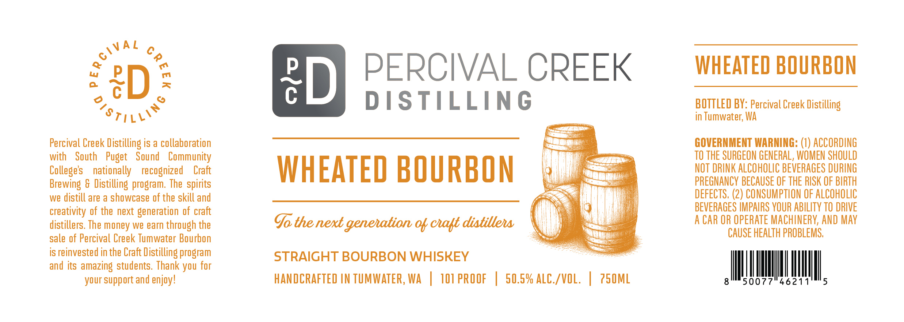

# TTB COLA Label Images - TTBID 26292001000527

**Brand Name:** PERCIVAL CREEK DISTILLING

**Issue Date:** 11/06/2026

**Origin Code:** 07

**Product Class/Type:** 101

**Source:** [TTB Public COLA Registry](https://ttbonline.gov/colasonline/viewColaDetails.do?action=publicFormDisplay&ttbid=26292001000527)

## Label Images

### Label 1

## Extracted Label Text

*Text extracted via OCR - may contain errors*

**Detected Proof:** 101.2

### Label 1

C
Lu
PERCIVAL CREEK
WHEATED BOURBON
eD
7
ED
(
DISTILLING
BOTTLED BY: Percival Creek Distilling
in Tumwater; WA
Percival Creek
Distilling is a collaboration
GOVERNMENT WARNING: (1) ACCORDING
with
South   Puget
Sound   Community
TO THE SURGEON GENERAL, WOMEN SHOULD
Colleges
nationally   recognized
Craft
WHEATED BOURBON
NOT DRINK ALCOHOLIC BEVERAGES DURING
Brewing & Distilling program. The spirits
PREGNANCY BECAUSE OF THE RISK OF BIRTH
we distill are a showcase of the skill and
DEFECTS, (2) CONSUMPTION OF ALCOHOLIC
creativity of the next generation of craft
BEVERAGES IMPAIRS YOUR ABILITY TO DRIVE
distillers. The money we earn through the
Go the next genehation %k calt distillehs
A CAR OR OpERATe MAChINERV; AND May
sale of Percival Creek Tumwater Bourbon
CAUSE HEALTH PROBLEMS;
is reinvested in the Craft Distilling program
STRAIGHT BOURBON WHISKEY
and its amazing students. Thank you for
your support and enjoy!
HANDCRAFTED IN TUMWATER, WA
10I PROOF
50.59 ALC_/VOL;
750ML
50077"46211
5
QCival
2
28TILLO`
