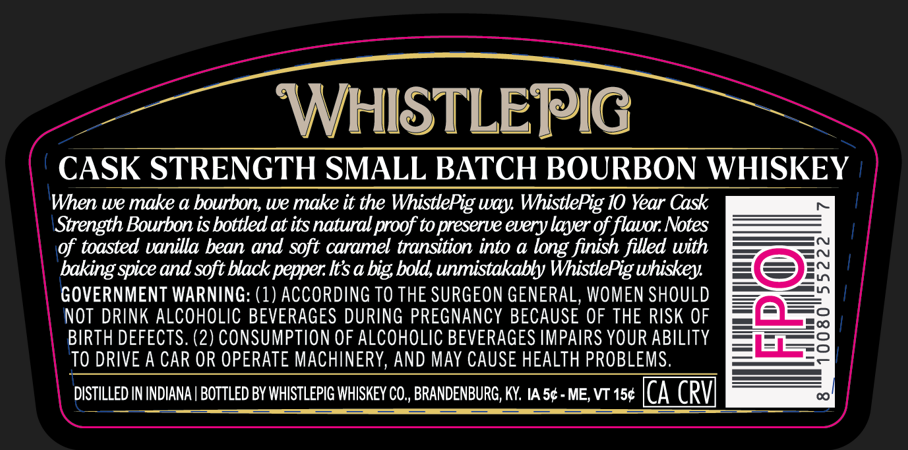
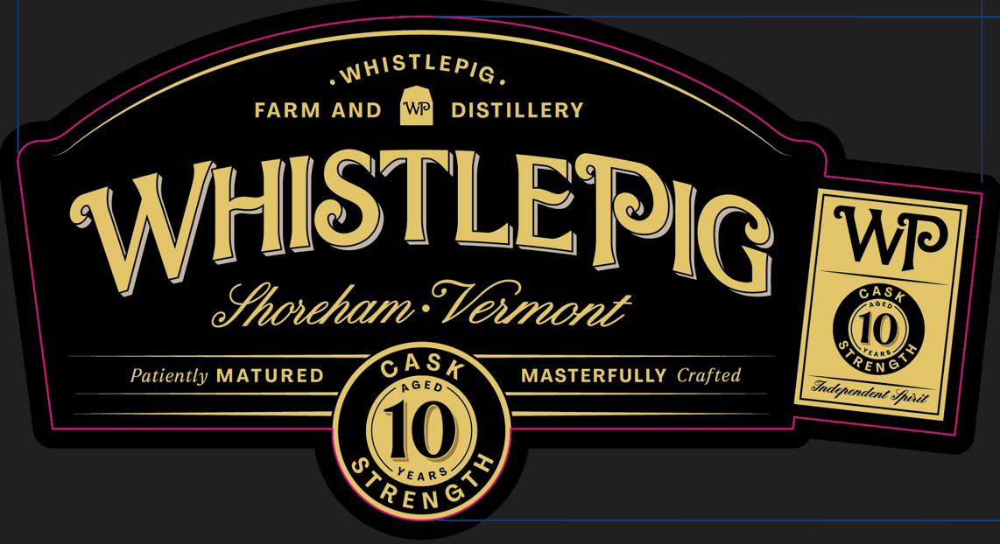
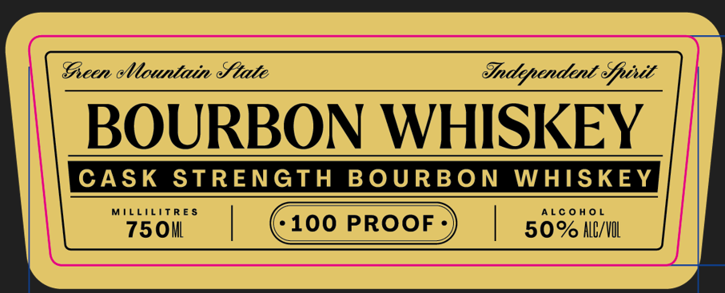
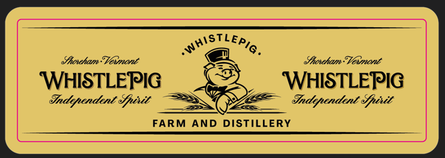

# TTB COLA Label Images - TTBID 26292001000535

**Brand Name:** WHISTLEPIG

**Issue Date:** 10/27/2026

**Origin Code:** 22

**Product Class/Type:** 141

**Source:** [TTB Public COLA Registry](https://ttbonline.gov/colasonline/viewColaDetails.do?action=publicFormDisplay&ttbid=26292001000535)

## Label Images

### Back Label

### Front Label

### Label 2

### Label 3

## Extracted Label Text

*Text extracted via OCR - may contain errors*

### Back Label

WHISTLEPIG
CASK STRENGTH SMALL BATCH BOURBON WHISKEY
When we make a bourbon; we make it the WhistlePig Way WhistlePig I0 Year Cask
Strength Bourbon is bottled at its natural proof to preserue every layer of flauor Notes
of toasted vanilla bean and soft caramel transition into a
finish filled with
baking spice and soft black pepper Its a big bold,unmistakably WhistlePig whiskey
GOVERNMENT WARNING: (1) ACCORDING TO THE SURGEON GENERAL, WOMEN SHOULD
NOT DRINK ALCOHOLIC BEVERAGES DURING PREGNANCY BECAUSE OF THE RISK OF
8
BIRTH DEFECTS: (2) CONSUMPTION OF ALCOHOLIC BEVERAGES IMPAIRS YOUR ABILITY
TO DRIVE A CAR OR OPERATE MACHINERY, AND MAY CAUSE HEALTH PROBLEMS.
DISTILLED IN INDIANA | BOTTLED BY WHISTLEPIG WHISKEY CO , BRANDENBURG,KY IA 5e- ME, VT 154 [CA CRVI
long

### Front Label

aie

FARM AND wr] DISTILLERY

ntly MATURED

a Aisi

MASTERFULLY Crafted

Thana

F

10

REN

### Label 2

Gieen Mountain Stale Sndipendent Gpcit
BOURBON WHISKEY

### Label 3

ST
Snosham "Vevmont
Shotham" Vexmont
WHISTLEPIG
WHISTLEPIG
Independent efpixit
Independent epivit
FARM
AND DISTILLERY
Lepig _
'Whs
