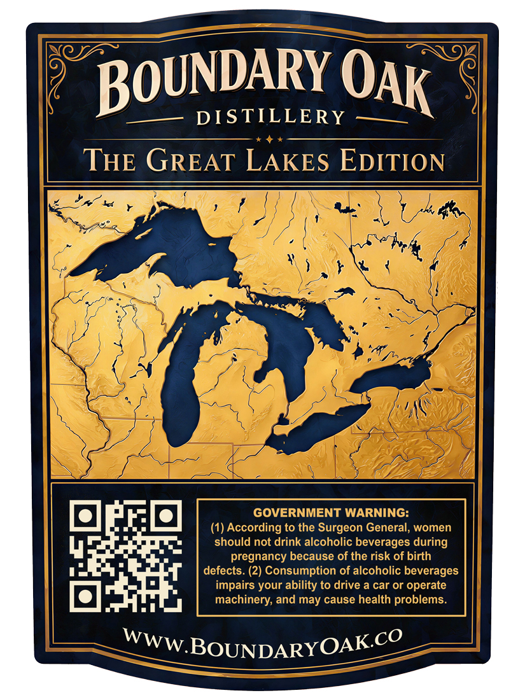
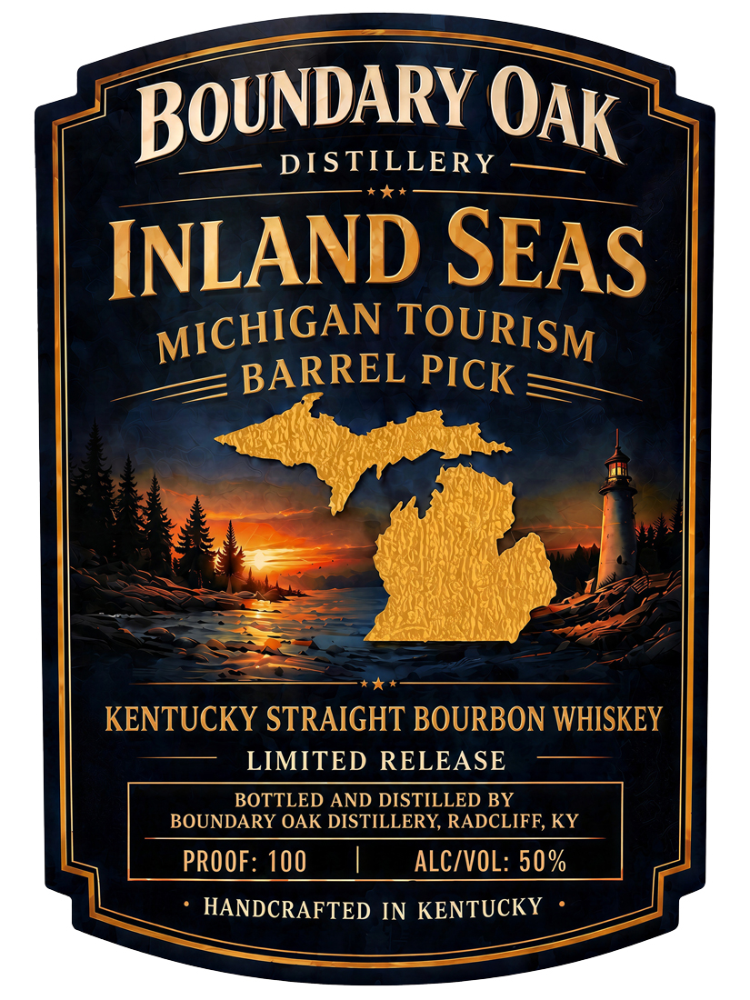

# TTB COLA Label Images - TTBID 26292001000554

**Brand Name:** INLAND SEAS

**Fanciful Name:** MICHIGAN BARREL PICK

**Issue Date:** 10/29/2026

**Origin Code:** 22

**Product Class/Type:** 101

**Source:** [TTB Public COLA Registry](https://ttbonline.gov/colasonline/viewColaDetails.do?action=publicFormDisplay&ttbid=26292001000554)

## Label Images

### Back Label

### Front Label

## Extracted Label Text

*Text extracted via OCR - may contain errors*

**Detected Proof:** 100

### Back Label

DIS TILLERY
THE GREAT LAKES EDITION
GOVERNMENT WARNING:
(1) According to the Surgeon General; women
should not drink alcoholic beverages
pregnancy because of the risk of birth
defects. (2) Consumption of alcoholic beverages
impairs your ability to drive a car or operate
machinery;
may cause health problems.
BOUNDARYOAKCO
BoUNDARY
OAK
during
and
WWW.

### Front Label

DIS TILLERY
INLAND SEAS
BARREL
KENTUCKY STRAIGHT BOURBON WHISKEY
LIMITED RELEASE
BOTTLED AND DISTILLED BY
BOUNDARY OAK DISTILLERY, RADCLIFF, KY
PROOF: 100
ALC/VOL: 50 %
HANDCRAFTED IN KENTUCKY
BoUNDARY
OAK
MICHIGAN
TOURISM
PICK
