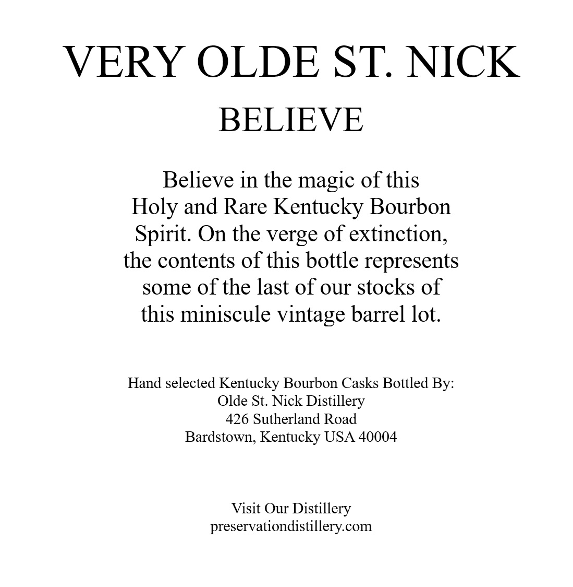
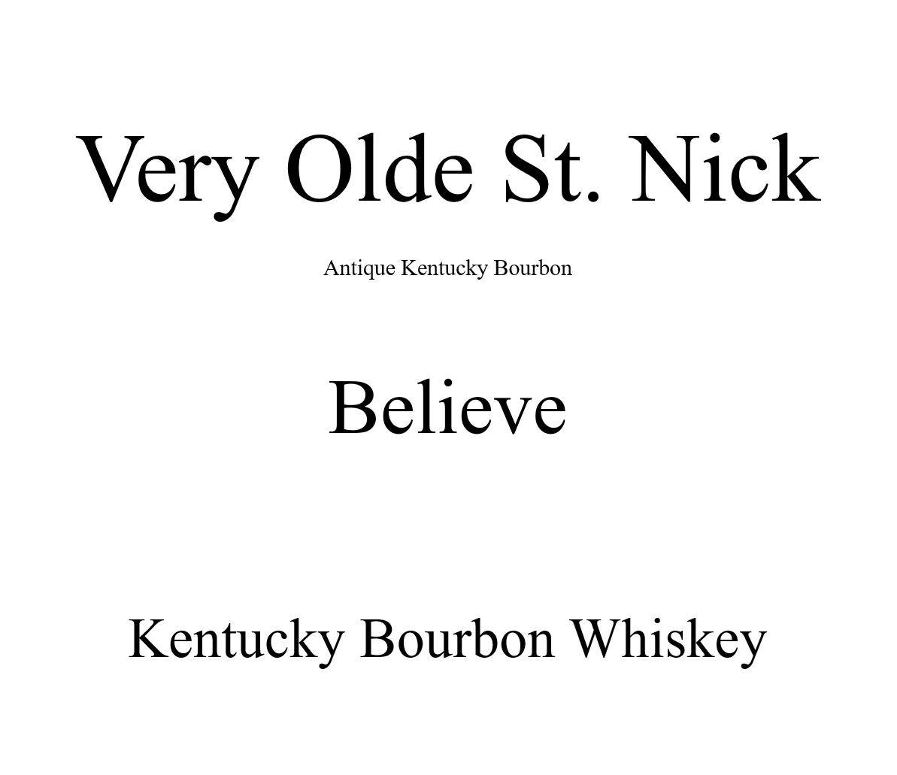
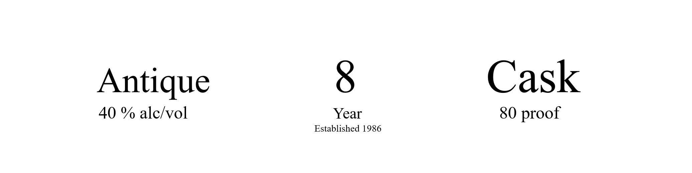
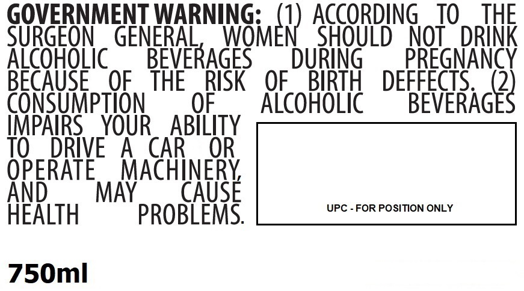

# TTB COLA Label Images - TTBID 26292001000561

**Brand Name:** VERY OLDE ST. NICK

**Issue Date:** 10/22/2026

**Origin Code:** 22

**Product Class/Type:** 141

**Source:** [TTB Public COLA Registry](https://ttbonline.gov/colasonline/viewColaDetails.do?action=publicFormDisplay&ttbid=26292001000561)

## Label Images

### Back Label

### Label 1

### Label 3

### Label 4

## Extracted Label Text

*Text extracted via OCR - may contain errors*

**Detected Proof:** 80

### Back Label

VERY OLDE ST: NICK
BELIEVE
Believe in the magic of this
Holy and Rare Kentucky Bourbon
Spirit: On the verge of extinction,
the contents of this bottle represents
some of the last of our stocks of
this miniscule vintage barrel lot:
Hand selected Kentucky Bourbon Casks Bottled By:
Olde St: Nick Distillery
426 Sutherland Road
Bardstown, Kentucky USA 40004
Visit Our Distillery
preservationdistillery com

### Label 1

Very Olde St. Nick

Antique Kentucky Bourbon

Believe

Kentucky Bourbon Whiskey

### Label 3

Antique

8

Cask

40 % alc/vol

Year

Established 1986

80 proof

### Label 4

GOVERNMENT WARNING:
ACCORDING
TO
THE
SURGEON
GENERAL,
INGmEr) AGOBD8
NOT
DRINK
AicoHoLic
BEVERAGES
DURiNG
PREGNANCY
BECAUSE
OF
THE
RISK
OF
BIRTH
DEFFECTS
2
CONSUMpTION
OF
AlcohoLic
BEVERAGES
IMPAIRS
YOUR
ABILITY
TO
DRIVE
A
CAR
OR
OPERATE
MACHINERY
And
MAY
CAUSE
UPC - FOR POSITION ONLY
HEALTH
PROBLEMS:
750ml
