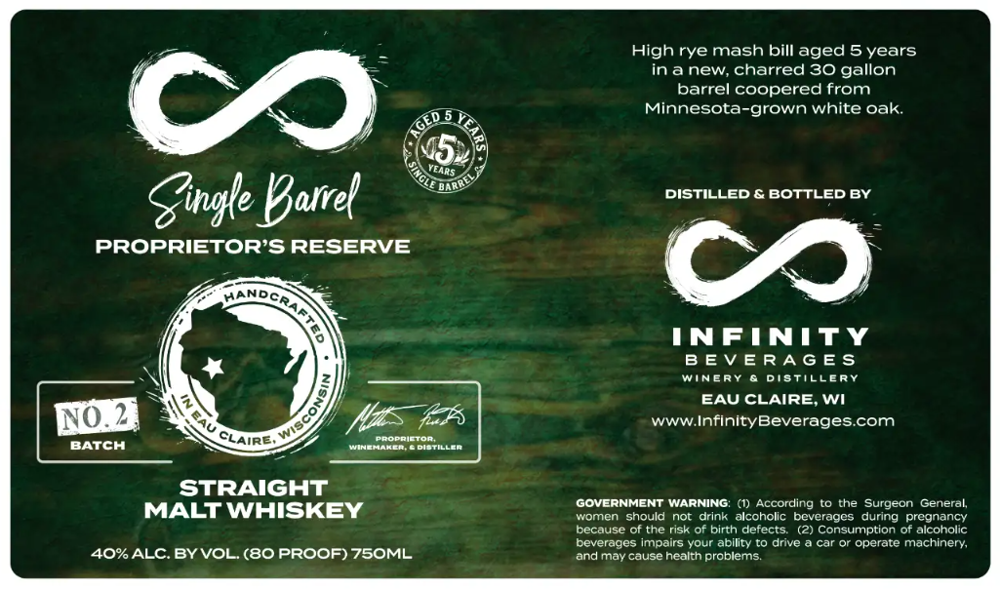

# TTB COLA Label Images - TTBID 26293001000079

**Brand Name:** PROPRIETOR'S RESERVE

**Issue Date:** 10/23/2026

**Origin Code:** 48

**Product Class/Type:** 117

**Source:** [TTB Public COLA Registry](https://ttbonline.gov/colasonline/viewColaDetails.do?action=publicFormDisplay&ttbid=26293001000079)

## Label Images

### Label 1

## Extracted Label Text

*Text extracted via OCR - may contain errors*

**Detected Age:** 5 Years

### Label 1

High rye mash bill aged 5 years
inanew, charred 30 gallon
barrel coopered from
Co
Minnesota-grown white oak
Gigle Varrel
DISTILLED & BOTTLED By
PROPRIETOR'S RESERVE
INFINITY
B EV ERAG Es
Winepy
Distillepy
8
EAU CLAIRE, Wi
E4
WWW InfinityBeverages com
BATCH
CLAIRE,
WineMroprietoctiller
STRAIGHT
MALT WHISKEY
GOVERNMENT WARNING;
According to the Surgeon
General;
women should not drink
alcoholic
beverages during
pregnancy
because of the risk of birth defects
(2) Consumption of alcoholic
beverages impairs your ability to drive
car Or operate machinery;
4O%ALC BYVOL(8O PROOF) 75OML
and may cause health prablems:
ears
Kandcr
N0A
wiscor
