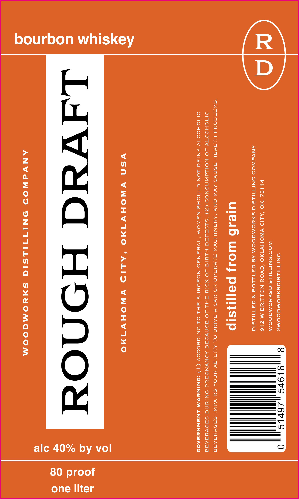

# TTB COLA Label Images - TTBID 26293001000081

**Brand Name:** ROUGH DRAFT

**Issue Date:** 11/02/2026

**Origin Code:** 37

**Product Class/Type:** 141

**Source:** [TTB Public COLA Registry](https://ttbonline.gov/colasonline/viewColaDetails.do?action=publicFormDisplay&ttbid=26293001000081)

## Label Images

### Label 1

## Extracted Label Text

*Text extracted via OCR - may contain errors*

**Detected Proof:** 80

### Label 1

bourbon whiskey

ONITILSIGSHYOMGOOMD

WOD'SNITTILSIGSHYOMGOOM

VILIEZL “MO ‘ALID VNOHV1MO ‘GVOY NOLLIN M Z16

ANVdWOD SONITILSIG SHHOMGOOM Ad GATILLOG * GATIILSIG

ulesB Wolds paj|iisip

“SW3A18 04d HLIVAH ASNVD AVW GNV ‘AYSNIHOVW ALVYRdO YO YVO V SAIN OL ALITIGVY YNOA SUHIVIW! SHOVYSRARE

DITOHODTV AO NOILAWNSNOD (Z) ‘SLOFARC HLYIG JO MSIY AHL AO ASNVOAE AONVNOAYd ONIYNG SSA9VYesARa
DITOHOOTY MNIYG LON GINOHS NAWOM ‘1VYSNS3D NOADYNS AHL OL ONIGHUOOOY (1) :SNINYVWM LNAWNYSAOD

YSN WWOHY1MO S‘ALID VWNWNOHY1NO

ANVWdWOD ONITITIILSIC SYHYOMAOCOM

by vol

alc 40%

80 proof

one liter
