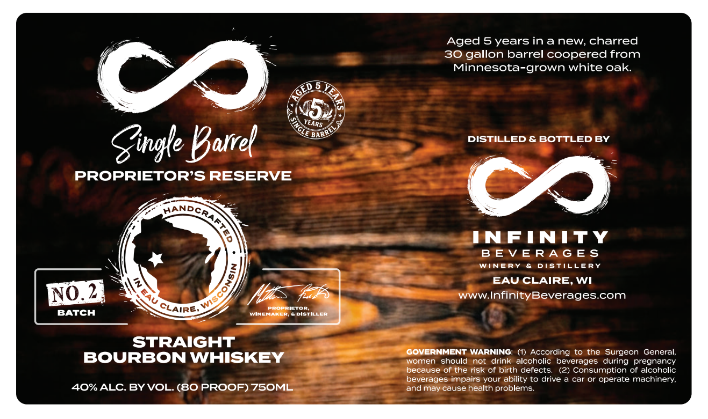

# TTB COLA Label Images - TTBID 26293001000084

**Brand Name:** PROPRIETOR'S RESERVE

**Issue Date:** 10/23/2026

**Origin Code:** 48

**Product Class/Type:** 101

**Source:** [TTB Public COLA Registry](https://ttbonline.gov/colasonline/viewColaDetails.do?action=publicFormDisplay&ttbid=26293001000084)

## Label Images

### Label 1

## Extracted Label Text

*Text extracted via OCR - may contain errors*

**Detected Proof:** 80
**Detected Age:** 5 Years

### Label 1

Aged 5 years ina new, charred
30
gallon barrel coopered from
Minnesota-grown white oak
C
45
Gigle Karrel
DISTILLED & BOTTLED BY
PROPRIETOR'S RESERVE
co
INFINITY
B E V ERA G Es
WINERY
Distillepy
EAU CLAIRE, WI
NO 2
I
7.4
WWW InfinityBeverages.com
[azetoR
BATCH
WUNEMA
Distiller
STRAIGHT
GOVERNMENT
WARNING: (1) According
to the Surgeon
General;
BOURBON WHISKEY
women
should
not
drink alcoholic beverages
pregnancy
because of the risk of birth defects
(2) Consumption of alcoholic
beverages impairs your ability to drive a car or operate machinery;
40%ALC.BY VOL. (80 PROOF) 75OML
and
cause health problems
5 YE
GED
1
VEARS
BARR
HAND
CRAE
8
)
CLAIRE,
during
may
