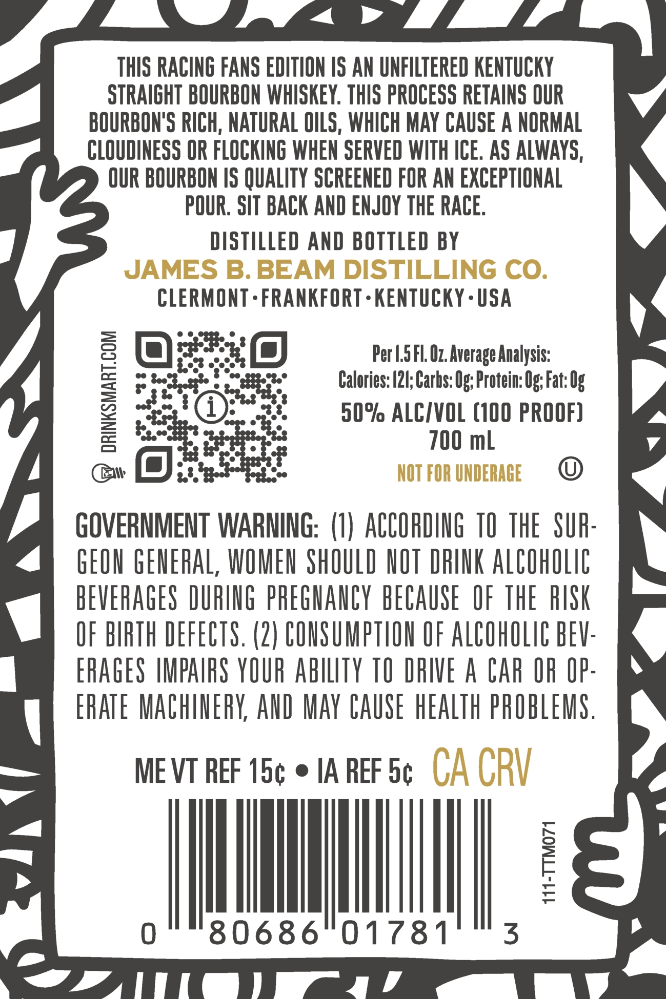
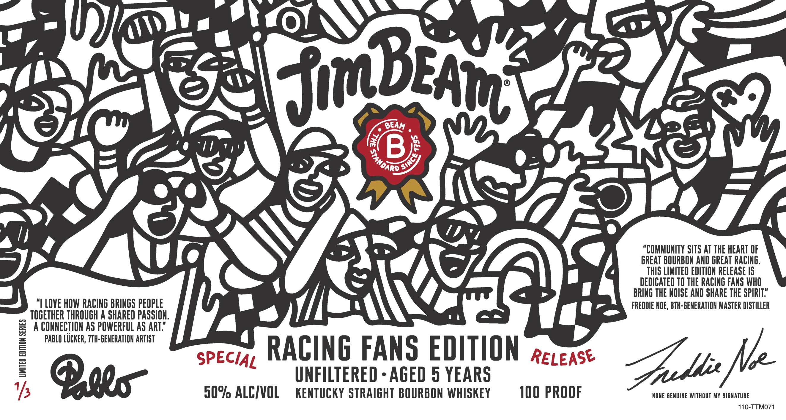
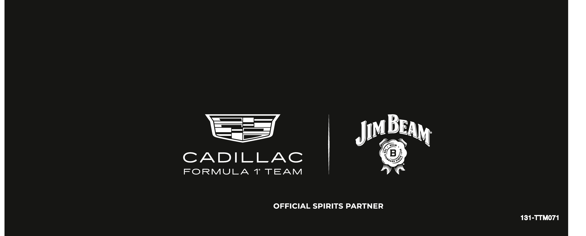

# TTB COLA Label Images - TTBID 26293001000088

**Brand Name:** JIM BEAM

**Issue Date:** 10/23/2026

**Origin Code:** 22

**Product Class/Type:** 101

**Source:** [TTB Public COLA Registry](https://ttbonline.gov/colasonline/viewColaDetails.do?action=publicFormDisplay&ttbid=26293001000088)

## Label Images

### Back Label

### Label 1

### Label 3

## Extracted Label Text

*Text extracted via OCR - may contain errors*

**Detected Proof:** 100
**Detected Age:** 5 Years

### Back Label

THIS RACING FANS EDITION IS AN UNFILTERED KENTUCKY
STRAIGHT BOURBON WHISKEY. THIS PROCESS RETAINS OUR
BOURBON'S RICH; NATURAL OLS, WHICH MAY CAUSE A NORMAL
CLOUDINESS OR FLOCKING WHEN SERVED WITH ICE. AS ALWAYS,
QUR BOURBON IS QUALITY SCREENED FOR AN EXCEPTIONAL
2
POUR; SIT BACK AND ENJOY THE RACE.
DISTILLED AND BOTTLED BY
JAMES B. BEAM DISTILLING CO.
CLERMONT - FRANKFORT - KENTUCKY . USA
Per L.5FL. Oz.Average Analysis:
Calories: |21; Carbs: Og; Protein: Og;Fat: Ug
1
50% ALCIVOL (100 PROOF)
700 ml
NOT FOR UNDERAGE
GOVERNMENT WARMING:   (1) ACCORDING TO THE   SUH:
GEON GENERAL, WOMEN ShOULD NOT DRINK AlCOhOLIC
BEVERAGES DURING pbeGUANCY bECAUSE   OF ThE   RISK
OF BIRTH DEFECTS. (2) COUSUMPTHON OF ALCOhOLIC BEV:
ERAGES /MPAIRS YOUR abilTy TO RIVE A CAr OR OP-
ERATE MachinebK AUD May CAuSe hEalTh pROBLEMS .
ME VT REF 15c
IA REF 5c
CA CRV
I8
80686"01781
3
ICX1

### Label 1

a
IJBe
BEAM
B
"COMMUNITY SITS AT THE HEART OF
GREAT BOURBON AND GREAT RACING,
THIS LIMITED EDITION RELEASE IS
DEDICATED TO THE RACING FANS WHO
BRING THE NOISE AND SHARE THE SPIRIT"
LOvE HOW RACING BRINGS PEOPLE
FREDDIE NOE , BTH-GENERATION MASTER DISTILLER
TOGETHER THROUGH A SHARED PASSION,
0
A CONNECTION AS POWERFUL AS ART"
PABLO L_CKER, ZTH-GENERATION ARTIST
SPEciaz RACING FANS EDITION
RELEASE
Qoeo"
UNFILTERED
AGED 5 YEARS
1/
509 ALCIVOL
KenTuCKY STRAIGHT BOURBON WHISKEY
100 PROOF
NONE GENUINE WITHOUT MY SIGMATURE
110-TTMO71
4
8
STANDARO
Since
Ke
Znt

### Label 3

3
CADILLAC
FORMULA
1"' TEAM
OFFICIAL SPIRITS PARTNER
131-TTMO71
BEAM
Jim
