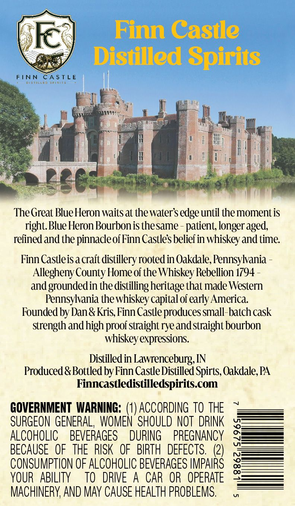
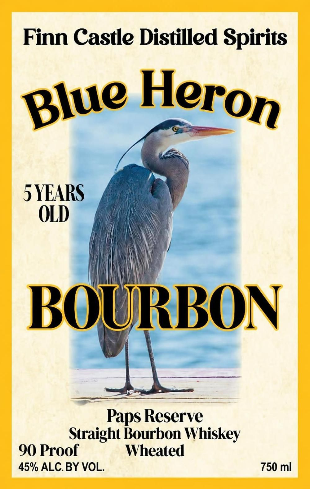

# TTB COLA Label Images - TTBID 26293001000155

**Brand Name:** FINN CASTLE DISTILLED SPIRITS

**Fanciful Name:** BLUE HERON 
PAP'S RESERVE 
STRAIGHT BOURBON WHISKEY
WHEATED

**Issue Date:** 10/23/2026

**Origin Code:** 39

**Product Class/Type:** 101

**Source:** [TTB Public COLA Registry](https://ttbonline.gov/colasonline/viewColaDetails.do?action=publicFormDisplay&ttbid=26293001000155)

## Label Images

### Back Label

### Label 1

## Extracted Label Text

*Text extracted via OCR - may contain errors*

**Detected Proof:** 90
**Detected Age:** 5 Years

### Back Label

Finn Castle

Ie,

Distilled Spirits

FINN

veri

Fira

SLE

The Great Blue Heron waits at the water's edge until the moment is

right. Blue Heron Bourbonis thesame - patient, longer aged,

refined and the pinnacle of Finn Castle's belief in whiskey and time.

Finn Castleis a crait distillery rooted in Oakdale, Pennsylvania -

Allegheny County Home of the Whiskey Rebellion 1794 -

and grounded in the distilling heritage that made Western

Pennsylvania the whiskey capital of early America.

Founded by Dan & Kris, Finn Castle produces small-batch cask

strength and high proof straight rye and straight bourbon

whiskey expressions.

Distilled in Lawrenceburg, IN

Produced & Bottled by Finn Castle Distilled Spirts, Oakdale, PA

Finncastledistilledspirits.com

GOVERNMENT WARNING: (1) ACCORDING TO THE

ALCOHOLIC BEVERAGES DURING PREGNANCY

SURGEON GENERAL, WOMEN SHOULD NOT DRINK

BECAUSE OF THE RISK OF BIRTH DEFECTS. (2)

CONSUMPTION OF ALCOHOLIC BEVERAGES IMPAIRS

YOUR ABILITY TO DRIVE A CAR OR OPERATE

MACHINERY, AND MAY CAUSE HEALTH PROBLEMS.

### Label 1

Finn Castle Distilled Spirits
5YEARS
OLD
BOURBON
Paps Reserve
Straight Bourbon Whiskey
90 Proof
Wheated
45% ALCBY VOL.
750 ml
Heron
Blue
