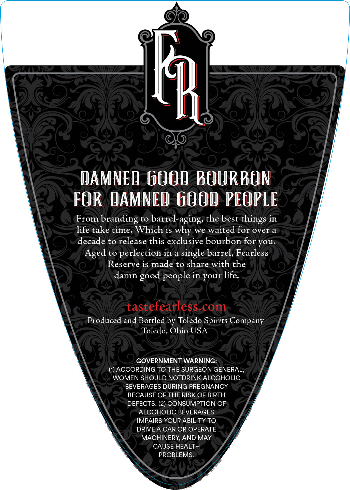
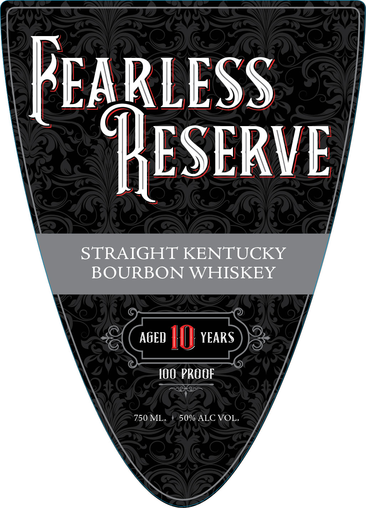

# TTB COLA Label Images - TTBID 26293001000194

**Brand Name:** FEARLESS

**Issue Date:** 10/27/2026

**Origin Code:** 09

**Product Class/Type:** 101

**Source:** [TTB Public COLA Registry](https://ttbonline.gov/colasonline/viewColaDetails.do?action=publicFormDisplay&ttbid=26293001000194)

## Label Images

### Back Label

### Front Label

## Extracted Label Text

*Text extracted via OCR - may contain errors*

**Detected Proof:** 100

### Back Label

K
DAMNED GOop BOURBON
FOR DAMNED GOO1 PEOPLE
From
branding
to
barrel-aging, the best
in
life take time: Which is why we waited for over a
decade to release this exclusive bourbon for you.
Aged
to
perfection in
single barrel, Fearless
Reserve is made to share with the
damn
in
life:
tastefearless com
Produced and Bottled by Toledo Spirits Company
Toledo
Ohio USA
GOVERNMENT WARNING:
ACCORDING TO THE SURGEON GENERAL
WOMEN SHOULD NOTDRINK ALCOHOLIC
BEVERAGES DURING PREGNANCY
BECAUSE OF THE RISK OF BIRTH
DEFECTS. (2) CONSUMPTION OF
ALCOHOLIC BEVERAGES
IMPAIRS YOUR ABILITY TO
DRIVEA CAR OR OPERATE
MACHINERY, AND MAY
CAUSE HEALTH
PROBLEMS:
things
good
people
your

### Front Label

EAKLESS

ESERVE

STRAIGHT KENTUCKY

BOURBON WHISKEY

agen ||) years

100. PROOF

750 ML.

50% ALC VOL,
