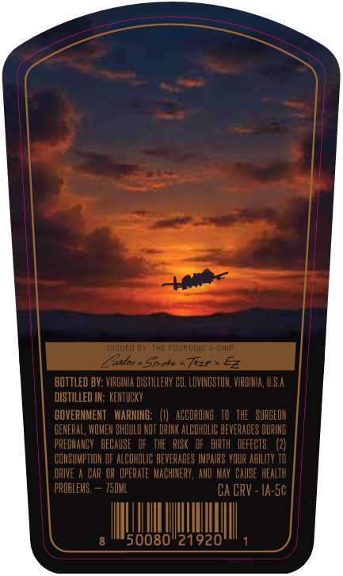
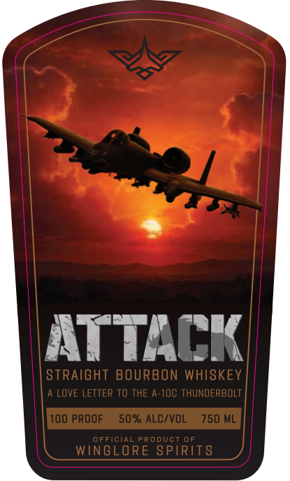

# TTB COLA Label Images - TTBID 26293001000296

**Brand Name:** ATTACK BOURBON

**Issue Date:** 10/26/2026

**Origin Code:** 05

**Product Class/Type:** 101

**Source:** [TTB Public COLA Registry](https://ttbonline.gov/colasonline/viewColaDetails.do?action=publicFormDisplay&ttbid=26293001000296)

## Label Images

### Back Label

### Front Label

## Extracted Label Text

*Text extracted via OCR - may contain errors*

**Detected Proof:** 100

### Back Label

133UE0 BY: ThE FOundIng 4-SHip
Lus*Sicke * Trzp * 64
BOTTLed BY: VIRBIHIA diSTILLERV CD; LOVINGSTOH; VIRGIIA, 4,SA;
DISTILLED IN: KEHTUCKY
GOVERNMENT   WARNING:
ACCORDING   TO  the   SURGEDN
GEHERAL, WOMEH SHOULD NOT DRIHK ALCOHOLIC BEVERABES OURIHG
FREGHAHCY   DECAUSE   OF   THE   RISk   OF   BIRTH   DEFECtS:;
COHSUMPTIOH @F ALCOHOLIC BEVEFAGES TMPMFS VDUP ABILITY TO
RIVE
CAR Op OpERATE   MACHINERV, AHD MAY  CAUSE  HeALTh
FRObLEMG:
750ML
CA CRV - Ia-Sc
50080"21920

### Front Label

ITtACK
STRAIGHT BOURBON WHISKEY
LOVE LETTER To THE A-10C ThuNdERBOLT
100 PROOF
50% ALC/VOL
750 ML
OFFICIAL PRODUCT 0F
WINGLORE SPIRIT8
