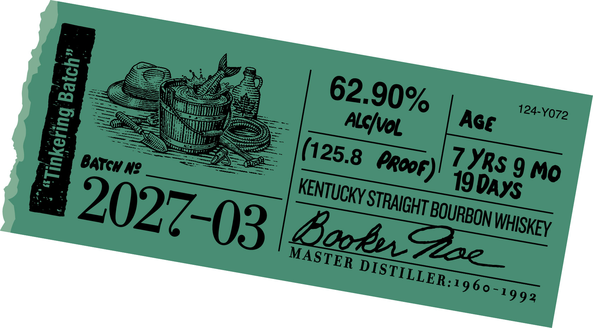
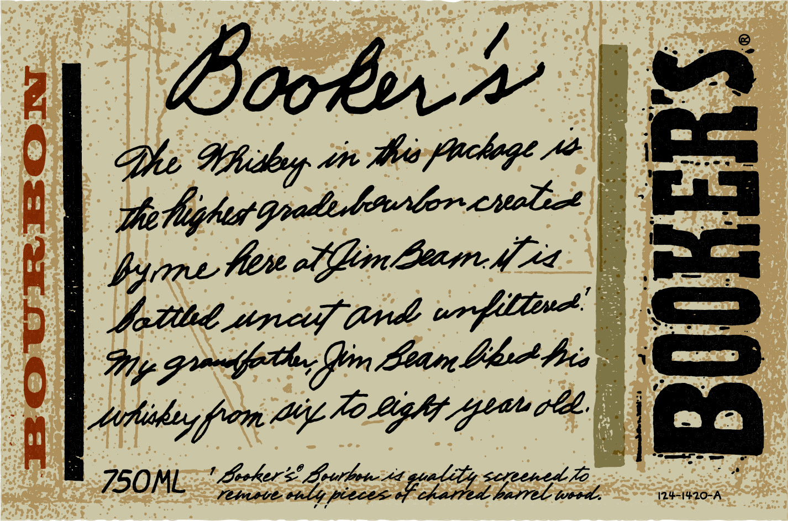
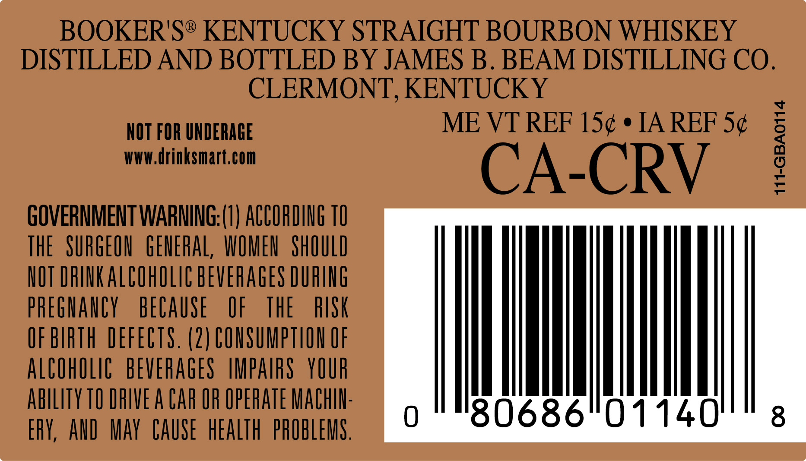
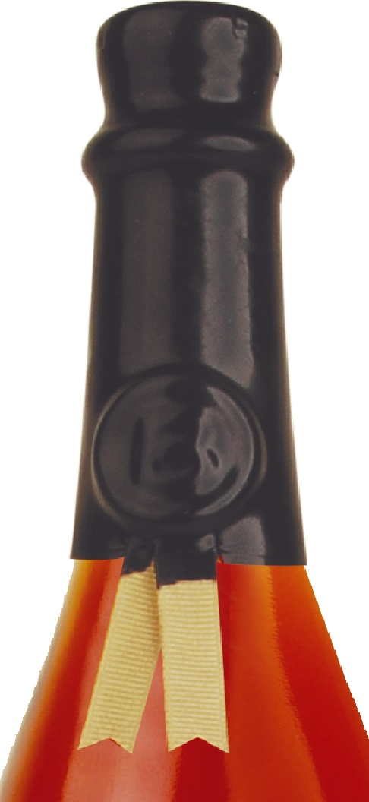

# TTB COLA Label Images - TTBID 26293001000301

**Brand Name:** BOOKER'S

**Issue Date:** 10/23/2026

**Origin Code:** 22

**Product Class/Type:** 101

**Source:** [TTB Public COLA Registry](https://ttbonline.gov/colasonline/viewColaDetails.do?action=publicFormDisplay&ttbid=26293001000301)

## Label Images

### Label 1

### Label 2

### Label 3

### Label 4

## Extracted Label Text

*Text extracted via OCR - may contain errors*

*1 image(s) excluded: text did not meet readability threshold*

**Detected Proof:** 125.8

### Label 1

7
Ne
9
19_
3
62.90%
124-Y072
0
Age
Alcivol
(125.8
YRs
proof)
BATGH _
Mo
DAYS
2027-03
KENTUCKY =
STRAIGHT |
BOURBON !
BBooeuoe
WHISKEY
MASTER
DISTILLER:1960-1992

### Label 2

Boob

De Whiithyy ste thes plochege 0

—_

polighes

one Hire offlim Learn ifr

pica

Sotihd wipers (rds un f Line

Gy gmt, in Lean bh heis

Mtiihiy from Ai 70 Ligh Geen

=<

aE Sse

### Label 3

BOOKER'S® KENTUCKY STRAIGHT BOURBON WHISKEY

DISTILLED AND BOTTLED BY JAMES B. BEAM DISTILLING CO.

CLERMONT, KENTUCKY

NOT FOR UNDERAGE

ME VT REF 15¢ ¢ IA REF 5¢

WWW.drinksmart.com

CA-CRV

GOVERNMENT WARNING:(1) ACCORDING 10

meme weenie

THE SURGEON GENERAL, WOMEN SHOULD

NOT DRINK ALCOHOLIC BEVERAGES DURING

PREGNANCY BECAUSE OF THE

RISK

OF BIRTH DEFECTS. (2) CONSUMPTION OF

ALCOHOLIC BEVERAGES IMPAIRS YOUR

ABILITY TO DRIVE A CAR OF OPERATE MACHIN

ERY, AND MAY CAUSE HEALTH PROBLEMS
