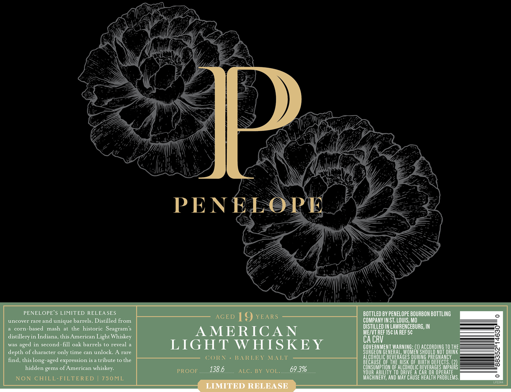

# TTB COLA Label Images - TTBID 26293001000582

**Brand Name:** PENELOPE

**Issue Date:** 11/05/2026

**Origin Code:** 29

**Product Class/Type:** 144

**Source:** [TTB Public COLA Registry](https://ttbonline.gov/colasonline/viewColaDetails.do?action=publicFormDisplay&ttbid=26293001000582)

## Label Images

### Front Label

### Label 2

## Extracted Label Text

*Text extracted via OCR - may contain errors*

*1 image(s) excluded: text did not meet readability threshold*

**Detected Proof:** 138.6
**Detected Age:** 19 Years

### Front Label

U
PENELOPE
PENELOPE $ LIMITED RELEA SES
BOTTLED BY PENELOPE BOURBON BOTTLING
uncover rare and
unique barrels. Distilled
AGED
19 YEARS
COMPANY IN ST; LOUIS, Mo
corn-based   mash
at the historic Seagram $
DISTILLED IN LAWRENCEBURG, IN
AMERICAN
MEIVT REF I5cIA REF Sc
distillery in Indiana, this American Light Whiskey
CA CRV
was
in second-fill oak barrels to reveal
LIGHT WHISKEY
ERMMEMT WARMING
ACCORDING TO THE
depth of character only time can unlock
rare
Goreeo
GENERAL
WHUGAE)SAGERRDHG BBTHE
find
this
expression is
tribute to the
CORN
BA RLEY
MLT
beHeFRGSS 8uBuke R degects"
hidden gems of American whiskey:
138.6_
69.3%
83
Io1
0 eQHOLICE
CBEVERAGEEL
DEFECTS
CIPARS
PROOF
ALC: BY
VOL:
CAR OR OPERATE
NON CHILL-FILTERED
750ML
YOCHHER  Twbo,Ap Cause HEACTa ProbLEmS.
LIMITED RELEASE
from
aged
long
aged
