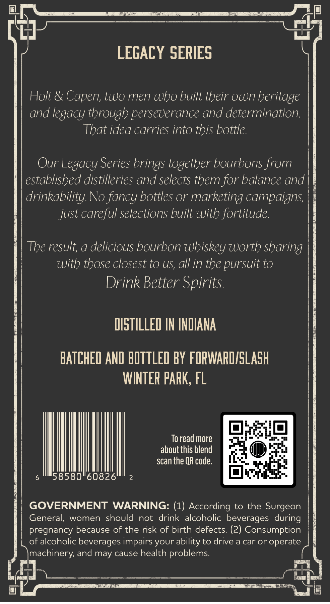
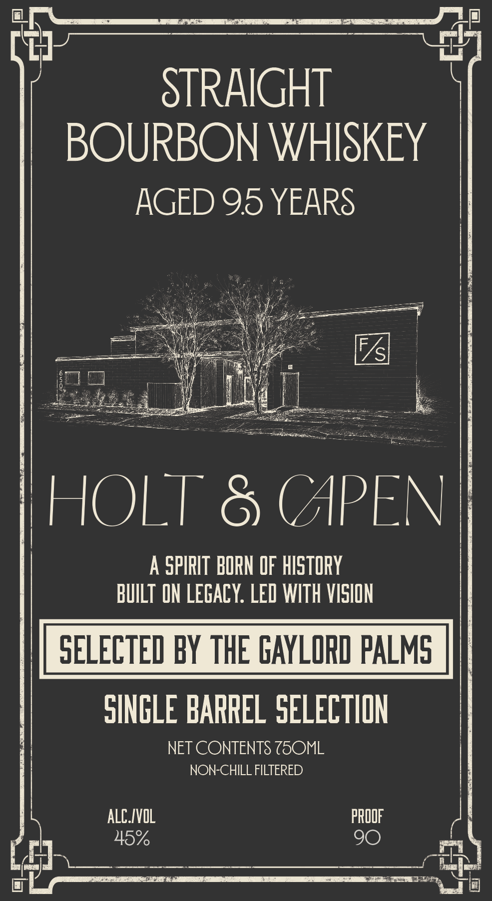

# TTB COLA Label Images - TTBID 26293001000653

**Brand Name:** HOLT & CAPEN

**Issue Date:** 10/23/2026

**Origin Code:** 16

**Product Class/Type:** 101

**Source:** [TTB Public COLA Registry](https://ttbonline.gov/colasonline/viewColaDetails.do?action=publicFormDisplay&ttbid=26293001000653)

## Label Images

### Back Label

### Front Label

## Extracted Label Text

*Text extracted via OCR - may contain errors*

**Detected Proof:** 90

### Back Label

LEGACY SERIES
Holt &
two men who built their own beritage
and legacy through perseverance and determination:
That idea carries into this bottle.
Our Legacy Series brings together bourbons from
established distilleries and selects them for balance and
drinkability. No fancy bottles or marketing campaigns;
just careful selections built with fortitude.
The result; a delicious bourbon wbiskey worth sharing
With those closest to US, all in the pursuit to
Drink Better Spirits.
DISTILLED IN INDIANA
BATCHED AND BOTTLED BY FORWARDISLASH
WINTER PARK, FL
To read more
about this blend
scan the QR code:
58580"60826
GOVERNMENT
WARNING: (1) According to the Surgeon
General;,
women
should
not
drink alcoholic beverages during
pregnancy because of the risk of birth defects: (2) Consumption
of alcoholic beverages impairs
ability to drive a car or operate
machinery, and may cause health problems:
Capen,
your

### Front Label

STRAIGHT
BOURBON WHISKEY
AGED 95 YEARS
{S
HOLT
8 (APEN
A SPIRIT BORN OF hISTORY
BuILT ON LEGACY: LED WITH VISION
SELECTED BY THE GAYLORD PALMG
SNGLE BARREL SELECTION
NET CONTENTS Z5OML
NON-CHILL FILTERED
ALC IVOL
pROOF
45%
90
