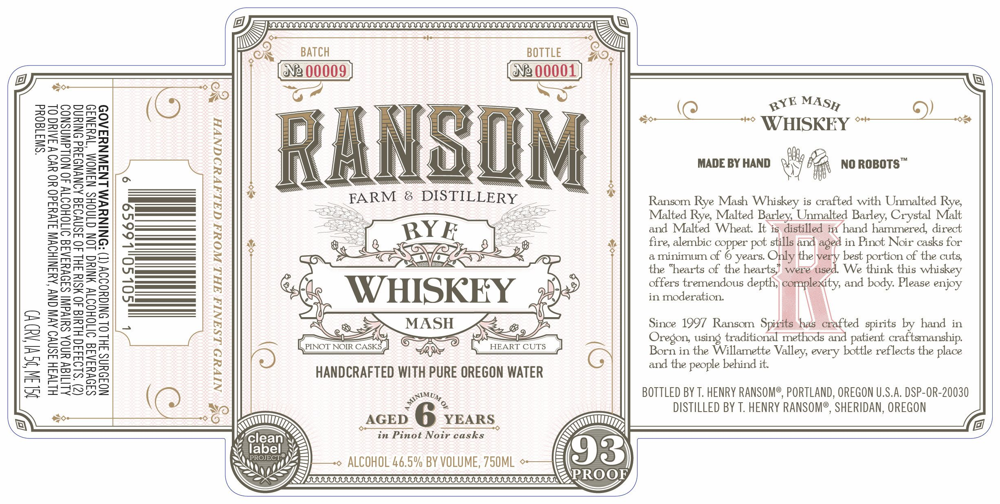

# TTB COLA Label Images - TTBID 26293001000757

**Brand Name:** RANSOM FARM & DISTILLERY

**Fanciful Name:** RYE MASH

**Issue Date:** 10/23/2026

**Origin Code:** 38

**Product Class/Type:** 142

**Source:** [TTB Public COLA Registry](https://ttbonline.gov/colasonline/viewColaDetails.do?action=publicFormDisplay&ttbid=26293001000757)

## Label Images

### Label 1

## Extracted Label Text

*Text extracted via OCR - may contain errors*

### Label 1

BATCH
BOTTLE
Ng 00009
Ne 00001
3
04
0
>
g
M
RANGDM
MADE BY HAND
VHSkH amamng
3
E
1
FARM
8
DISTILLERY
Ransom Rye Mash Whiskey is crafted with Unmalted Rye
F64
J
Malted Rye, Malted Barley Unmalted Barley, Crystal Malt
RYE
and Malted
Wheat: It is distilled
in hand hammered  direct
9
=
3
fire, alembic copper
stills and
in Pinot Noir casks for
6
4
2

theiniearts &
years:
Only the very best portion of the cuts;
1
the "hearts
the hearts;
were used
We think this whiskey
2
8
WHISKEY
offers tremendous depth; complexity, and body Please enjoy
3
in moderation:
2
0
1
1
MASH
Since 1997 Ransom  Spirits has crafted spirits by hand in
Oregon using traditional methods and patient craftsmanship
1
2
PINOT NOIR CASKS
HEART CUTS
Born in the Willamette
every bottle reflects the place
Eye
8
HANDCRAFTED WITh PURE OREGON WATER
and the people behind it.
2
BOTTLED BY T. HENRY RanSoMe, PORTLAND, OREGON U,S.A. DSP-OR-20030
DISTILLED BY T. HENRY RANSOMe, SHERIDAN, OREGON
AGED
YEARS
clean
in Pinot Noir casks
labels
93
ALCOHOL 46.5% BY VOLUME, 75OML
SUUUUUUUUUUUUUUUUUUUUUUUUUUUUUUUUUUUUUUUUUU
PROOF
MASH
RYE
pot
aged
Valley;
ANIMUM
