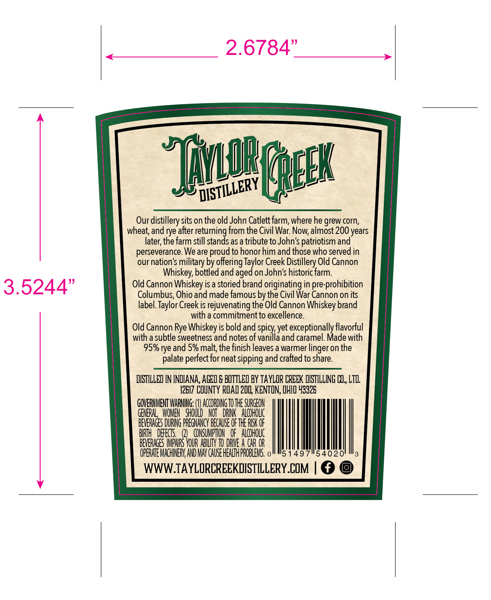
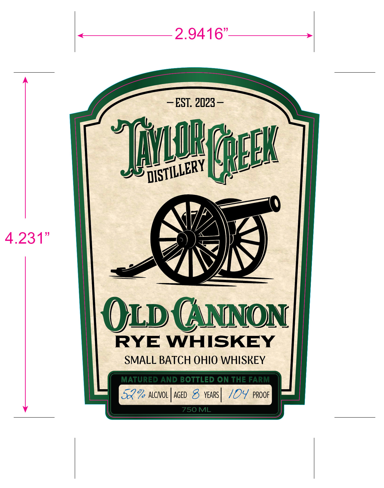
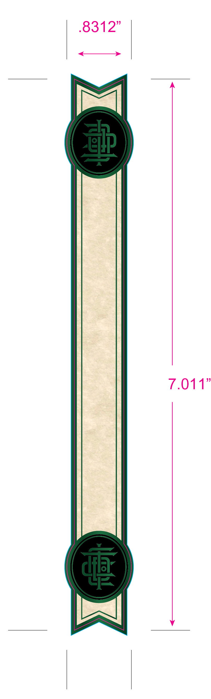

# TTB COLA Label Images - TTBID 26293001000817

**Brand Name:** OLD CANNON RYE WHISKEY

**Fanciful Name:** SMALL BATCH OHIO WHISKEY

**Issue Date:** 10/23/2026

**Origin Code:** 09

**Product Class/Type:** 142

**Source:** [TTB Public COLA Registry](https://ttbonline.gov/colasonline/viewColaDetails.do?action=publicFormDisplay&ttbid=26293001000817)

## Label Images

### Back Label

### Front Label

### Label 3

## Extracted Label Text

*Text extracted via OCR - may contain errors*

*1 image(s) excluded: text did not meet readability threshold*

**Detected Proof:** 104
**Detected Age:** 8 Years

### Back Label

2.6784"

a

Our distillery sits on the old John Catlett iaillenaisontheniddeh neice ene heuey where he grew corn,
wheat, and rye after returning from the Civil War. Now, almost 200 years
later, the farm still stands as a tribute to John’s patriotism and
perseverance. We are proud to honor him and those who served in
our nation’s military by offering Taylor Creek Distillery Old Cannon
Whiskey, bottled and aged on John's historic farm.
3 5 244” Old Cannon Whiskey is a storied brand originating in pre-prohibition
< Columbus, Ohio and made famous by the Civil War Cannon on its

<_____

label. Taylor Creek is rejuvenating the Old Cannon Whiskey brand
with a commitment to excellence.

Old Cannon Rye Whiskey is bold and spicy, yet exceptionally flavorful
with a subtle sweetness and notes of vanilla and caramel. Made with
95% rye and 5% malt, the finish leaves a warmer linger on the
palate perfect for neat sipping and crafted to share.

DISTILLED IN INDIANA, AGED & BOTTLED BY TAYLOR CREEK DISTILLING C0, LTD.
12617 COUNTY ROAD 200, KENTON, OHIO 43326

GOVERNMENT WARNING: enn THE SURGEON
GENERAL, WOMEN SHOULD NOT DRINK ALCOHOLIC
BEVERAGES DURING PREGANCY BECAUSE OFTHE RISK OF
BIRTH DEFECTS, AF CONSUMPTION OF ALCOHOLIC
BEVERAGES IMPAIRS YOUR ABILITY TO DRIVE A CAR OR

OPERATE MACHINERY, AND MAY CAUSE HEALTH PROBLEMS. o” #5 1497"54020

WWW.TAYLORCREFKMISTILLERY.COM | @ ©

### Front Label

2.9416"
EST. 2023
S
IAEEL
4.231"
OLD GNNON
RYE
WHISKEY
SMALL BATCH OHIO WHISKEY
MATURED AND BOTTLED ON THE FARM
522 ALCNOL
AGED 8
YEARS |
104 PROof
750ML
'DISTILLERY
