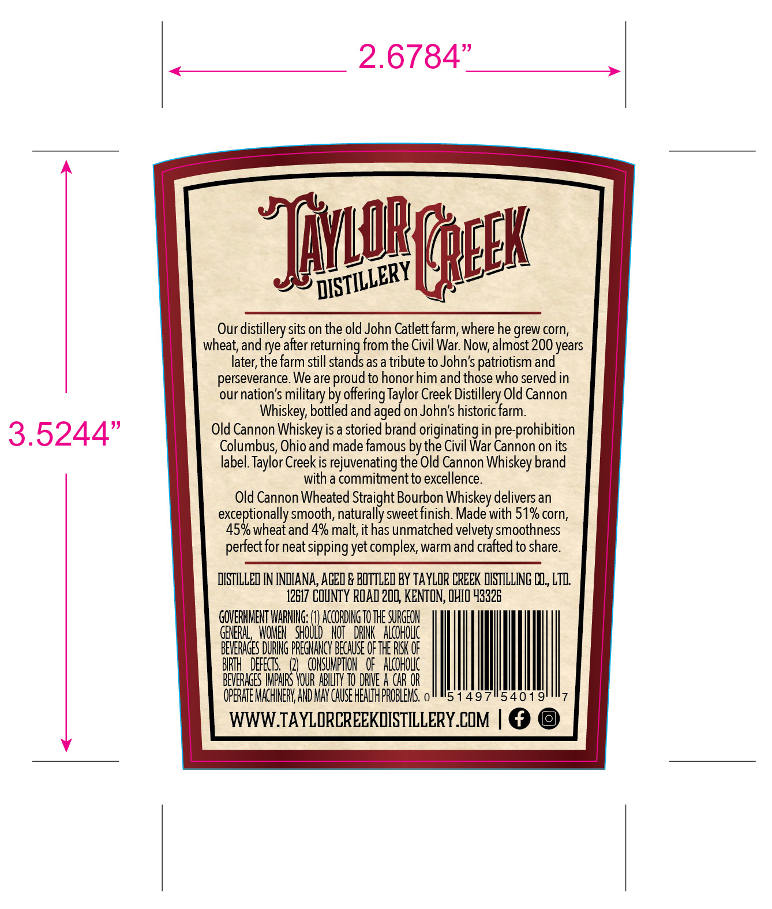
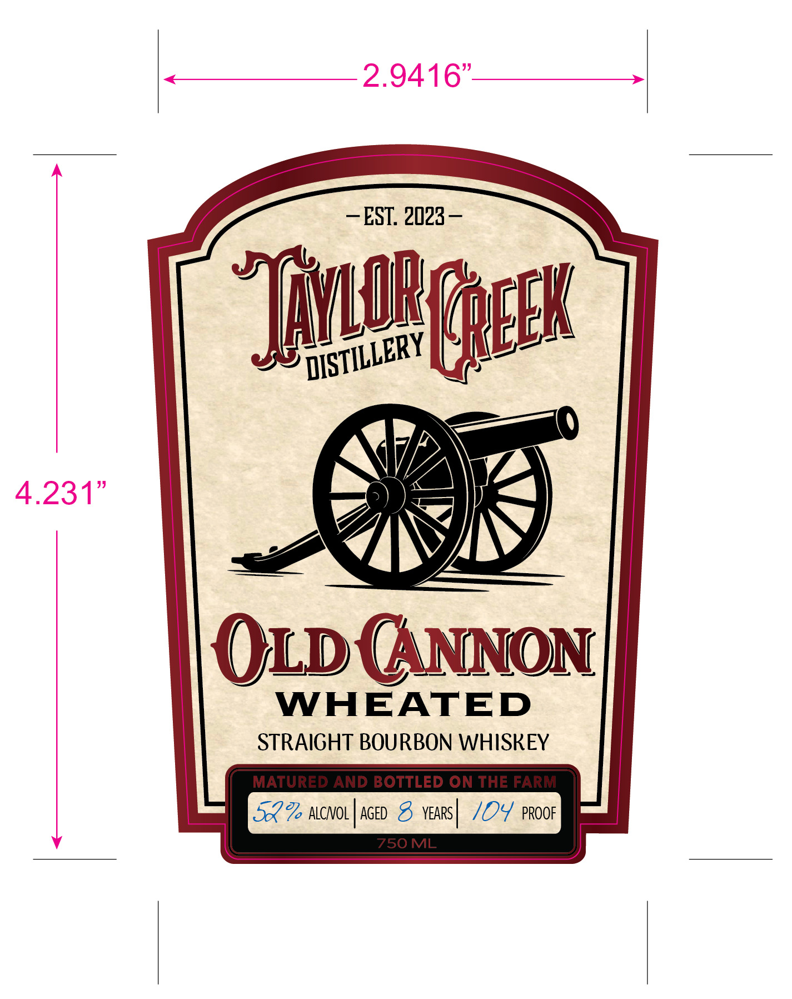
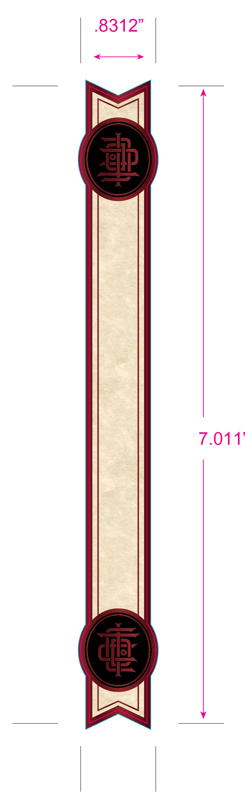

# TTB COLA Label Images - TTBID 26293001000819

**Brand Name:** OLD CANNON WHEATED STRAIGHT BOURBON WHISKEY

**Issue Date:** 10/23/2026

**Origin Code:** 09

**Product Class/Type:** 101

**Source:** [TTB Public COLA Registry](https://ttbonline.gov/colasonline/viewColaDetails.do?action=publicFormDisplay&ttbid=26293001000819)

## Label Images

### Back Label

### Front Label

### Label 3

## Extracted Label Text

*Text extracted via OCR - may contain errors*

*1 image(s) excluded: text did not meet readability threshold*

**Detected Proof:** 104
**Detected Age:** 8 Years

### Back Label

2.6784"
'TiOB geek
Our distillery sits on the old John Catlett farm, where he grew corn,
wheat; and rye after returning from the Civil War
almost 200 years
later; the farm still stands asa tribute to John's patriotism and"
perseverance. We are proud to honorhim and those who served in
our nation's
by offering Taylor Creek Distillery Old Cannon
Whiskey; bottled and aged on John's historic farm:
3.5244"
Old Cannon Whiskey is a storied brand originating in pre-prohibition
Columbus, Ohio and made famous by the Civil War Cannon on its
label Taylor Creekis rejuvenating the Old Cannon Whiskey brand
with a commitment to excellence.
Old Cannon Wheated Straight Bourbon Whiskey delivers an
exceptionally smooth, naturally =
finish Made with 51% corn,
45% wheat and 4% malt;, ithas unmatched velvety smoothness
for neat sipping yet complex; warm and crafted to share.
@ISTILLED IN INDIANA,AGED & BOTTLED BY TAYLOR CREEK DISTILLNG @, LTi:
12E17 COUNTY RQAD 200, KENTON; QHIQ 43326
GOVERHMENT WArNG;=
AccORDNg TO THE SURGEON
GENERAL   WOMEN   SHOULD   NOT   DRINK   Alcoholc
BeVeRAGES DURING PREGNANcY BEchuse OF THE RISK OF
BRTH   DEFEcTS
CONSUMPTIOU   oF   Alcohouc
BEVERAGES MPHRS YOuR ABI TO DRUE A CAR OR
OPERHTE MAcHINERY AND MAY CHUSE HEALTHPROBLEMS, 0
51497
54019
WWW TAYLORCREEKDISTILLERY.COM
'DISTILLERY
Now; "
military =
sweet
perfect

### Front Label

2.9416"
EST. 2023
S
Typeex
4.231"
OLD GNNON
WHEATED
STRAIGHT BOURBON WHISKEY
MATURED AND BOTTLED ON THE FARM
522 ALCNOL
AGED 8
YEARS
104 pROOF
750ML
'DISTILLERY
