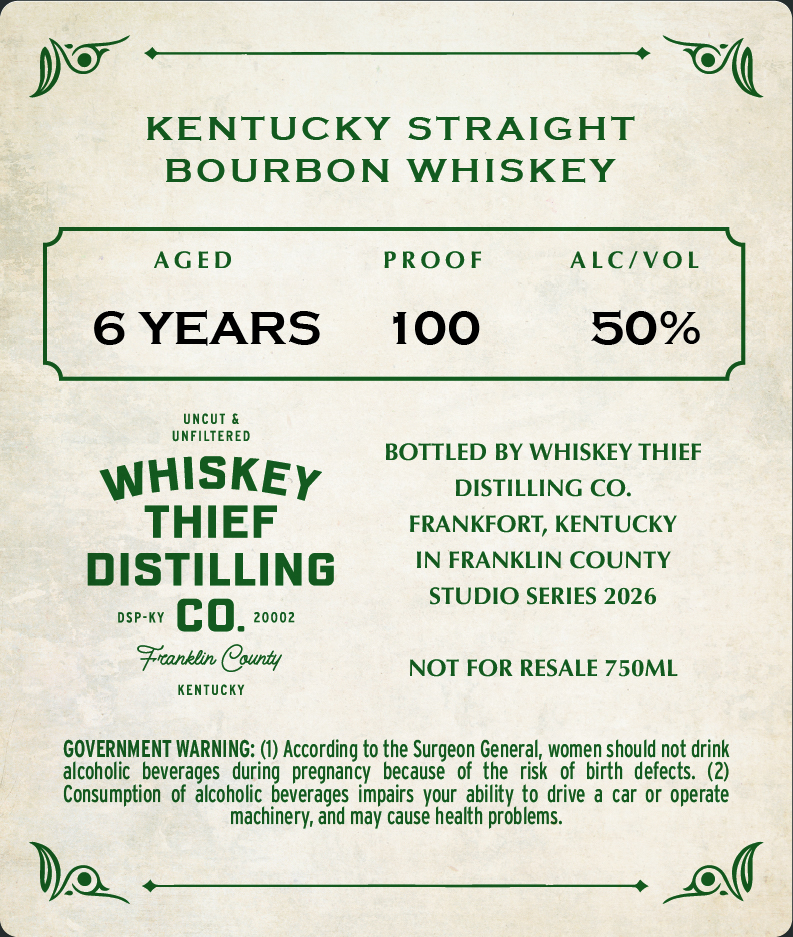
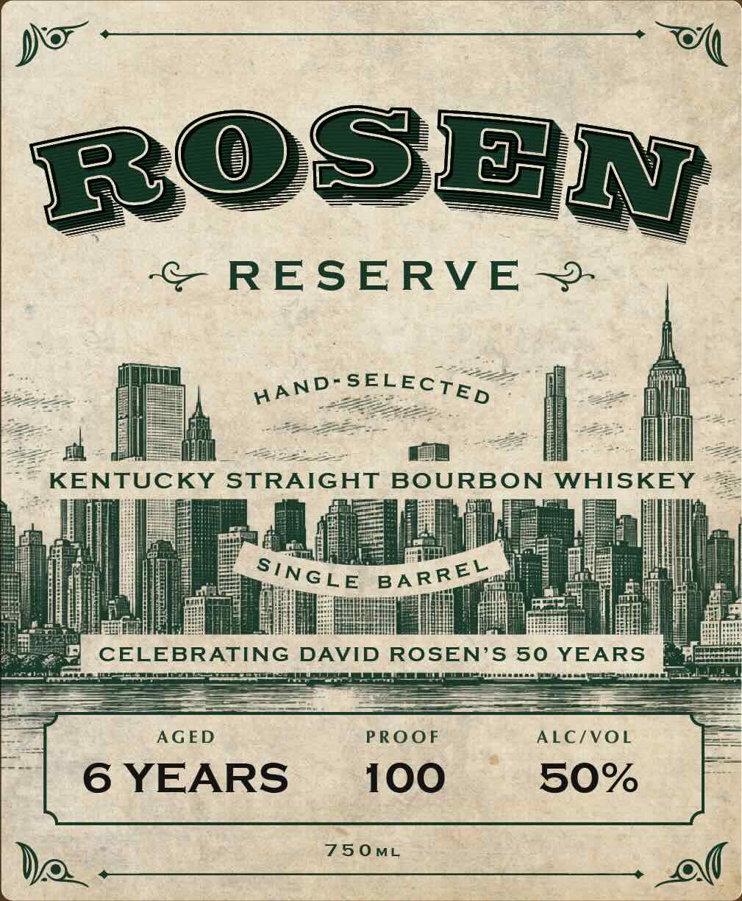

# TTB COLA Label Images - TTBID 26294001000038

**Brand Name:** WHISKEY THIEF DISTILLING CO.

**Fanciful Name:** ROSEN RESERVE

**Issue Date:** 10/23/2026

**Origin Code:** 22

**Product Class/Type:** 101

**Source:** [TTB Public COLA Registry](https://ttbonline.gov/colasonline/viewColaDetails.do?action=publicFormDisplay&ttbid=26294001000038)

## Label Images

### Back Label

### Front Label

## Extracted Label Text

*Text extracted via OCR - may contain errors*

**Detected Proof:** 100
**Detected Age:** 6 Years

### Back Label

KENTUCKY
STRAIGHT
BOURBON
WHISKEY
AGED
PROOF
ALC/VOL
6 YEARS
100
50%
UncUT
UNFILTERED
BOTTLED BY WHISKEY THIEF
WHISKEY
DISTILLING CO.
THIEF
FRANKFORT, KENTUCKY
DISTILLING
IN FRANKLIN COUNTY
STUDIO SERIES 2026
DSP-KY
co.
20002
Fronblin County
NOT FOR RESALE 750ML
KEnTUcKY
GOVERNMENT WARNING: (1) According to the Surgeon General, women should not drink
alcoholic   beverages   during   pregnancy
because
of the risk   of  birth  defects. (2)
Consumption   of alcoholic beverages impairs vour  ability to drive a car or operate
machinery; and may cause health problems

### Front Label

ROSEN
RESERVE
KENTUCKY STRAIGHT BOURBON
WHISKEY
CELEBRATING
DAVID ROSEN'S 50 YEARS
AGED
PROOF
ALC/VOL
6 YEARS
100
50%
750ML
SELECTED
AAND -
SINGLE
BA RREL
