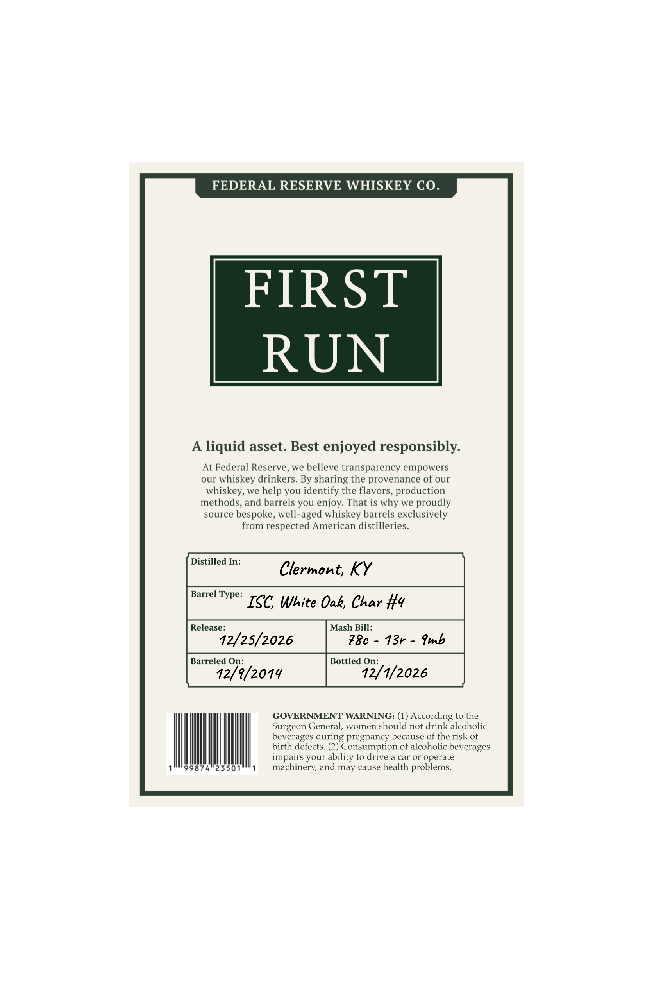
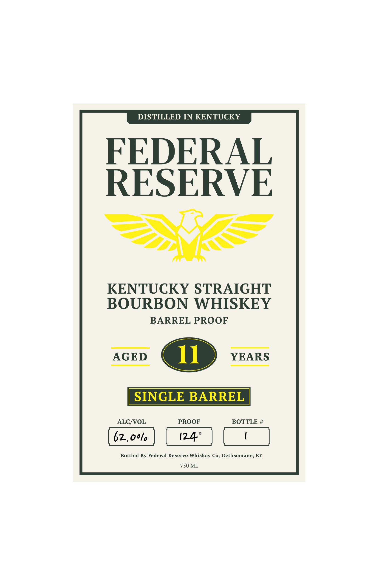

# TTB COLA Label Images - TTBID 26294001000102

**Brand Name:** FEDERAL RESERVE

**Issue Date:** 11/03/2026

**Origin Code:** 22

**Product Class/Type:** 101

**Source:** [TTB Public COLA Registry](https://ttbonline.gov/colasonline/viewColaDetails.do?action=publicFormDisplay&ttbid=26294001000102)

## Label Images

### Back Label

### Front Label

## Extracted Label Text

*Text extracted via OCR - may contain errors*

**Detected Age:** 11 Years

### Back Label

FEDERAL RESERVE WHISKEY CO
FIRST
RUN
liquid asset. Best enjoyed responsibly.
At Federal Reserve, we believe transparency empowers
our whiskey drinkers. By sharing the provenance of our
whiskey, we help you identify the flavors, production
methods, and barrels you enjoy. That is why we proudly
source bespoke, well -
whiskey barrels exclusively
from respected American distilleries.
Distilled In:
Clermont;
Ky
Barrel Type:
ISC White Oak, Char #y
Release:
Mash Bill:
12/25/2026
78c
13r
Imb
Barreled On:
Bottled On:
12/9/2014
12/1/2026
GOVERNMENT WARNING: (1)
According to the
Surgeon General, women should not drink alcoholic
beverages
pregnancy because of the risk of
birth defects. (2) Consumption of alcoholic beverages
impairs your ability to drive a car or operate
99874"23501
machinery, and may cause health problems_
aged
during

### Front Label

DISTILLED IN KENTUCKY
FEDERAL
RESERVE
KENTUCKY STRAIGHT
BOURBON WHISKEY
BARREL PROOF
AGED
11
YEARS
SINGLE BARREL
ALCNOL
PROOF
BOTTLE #
62,oo/
(24"
Bottled By Federal Reserve Whiskey Co, Gethsemane, KY
750 ML
