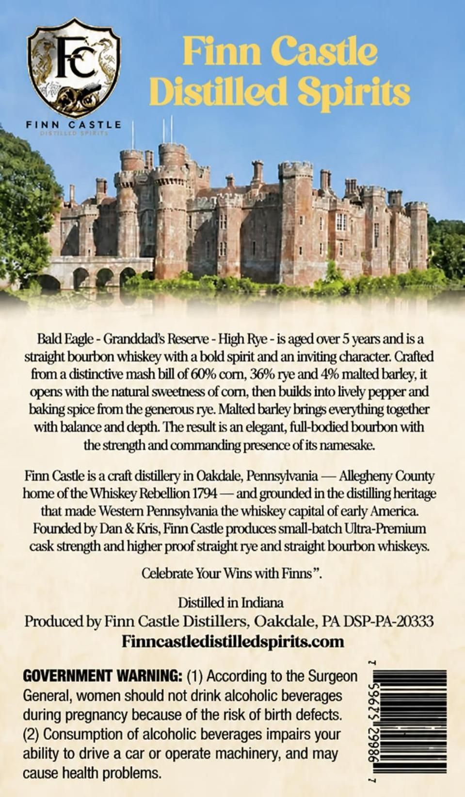
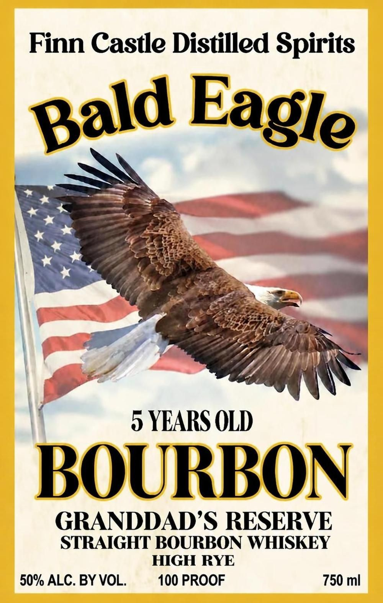

# TTB COLA Label Images - TTBID 26294001000116

**Brand Name:** FINN CASTLE DISTILLED SPIRITS

**Fanciful Name:** BALD EAGLE BOURBON GRANDDAD'S RESERVE

**Issue Date:** 10/29/2026

**Origin Code:** 39

**Product Class/Type:** 101

**Source:** [TTB Public COLA Registry](https://ttbonline.gov/colasonline/viewColaDetails.do?action=publicFormDisplay&ttbid=26294001000116)

## Label Images

### Back Label

### Front Label

## Extracted Label Text

*Text extracted via OCR - may contain errors*

**Detected Proof:** 100
**Detected Age:** 5 Years

### Back Label

Finn Castle
Distilled Spirits
FINN
CASTLE
0 | 1- |4 L | (
Bald Eagle - Granddads Reserve - High Rye - is
over 5 years andisa
straight bourbon whiskey with a bold spirit and an inviting character: Crafted
from a distinctive mash bill of 6% corn;, 36% rye and 4% malted barley; it
opens with the natural sweetness of corn, then buikds into lively pepper and
baking spice from the generous rye. Malted barley'
everything together
with balance and depth: The result is an elegant; full-bxdied bourbon with
the strength and commanding presence ofits namesake
Finn Castle is a craft distillery in Oakdale; Pennsylvania
Allegheny County
home ofthe Whiskey Rebellion 1794-
and grounded in the distilling heritage
that made Western Pennsylvania the whiskey capital of early America
Founded by Dan & Kris, Finn Castle proxdluces small-batch Ultra-Premium
cask strength and higher _
straight rye and straight bourbon whiskeys:
Celebrate Your Wins with Finns
Distilled in Indiana
Produced by Finn Castle Distillers; Oakdale, PA DSP-PA-20333
Finncastledistilledspirits com
GOVERNMENT WARNING: (1) According to the Surgeon
General, women should not drink alcoholic beverages
during pregnancy because of the risk of birth defects.
(2) Consumption of alcoholic beverages impairs your

ability to drive a car or operate machinery; and may
cause health problems
aged .
brings €
proof

### Front Label

Finn Castle Distilled Spirits
5 YEARS OLD
BOURRON
GRANDDADS RESERVE
STRAIGHT BOURBON WHISKEY
HIGH RYE
50% ALC. BY VOL.
100 PROOF
750 ml
Eagle
Bald
