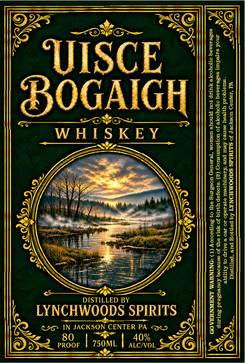

# TTB COLA Label Images - TTBID 26294001000155

**Brand Name:** LYNCHWOODS SPIRITS

**Fanciful Name:** UISCE BOGAIGH

**Issue Date:** 11/04/2026

**Origin Code:** 39

**Product Class/Type:** 140

**Source:** [TTB Public COLA Registry](https://ttbonline.gov/colasonline/viewColaDetails.do?action=publicFormDisplay&ttbid=26294001000155)

## Label Images

### Label 1

## Extracted Label Text

*Text extracted via OCR - may contain errors*

### Label 1

i ISCE ‘MN |
| Y FEA
Iles Bisco ec \ leas
I WHISKEY lie
i} Za | 528
OY, ini acae ‘0 HI] 8 ¢
HW) NaF dite WARE
||| ee ie eaten: $86 || 28 53
| A\ Rr eree |S |||\ 2228
||, LYNCHWOODS SPIRITS aE
