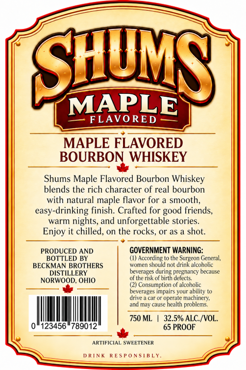
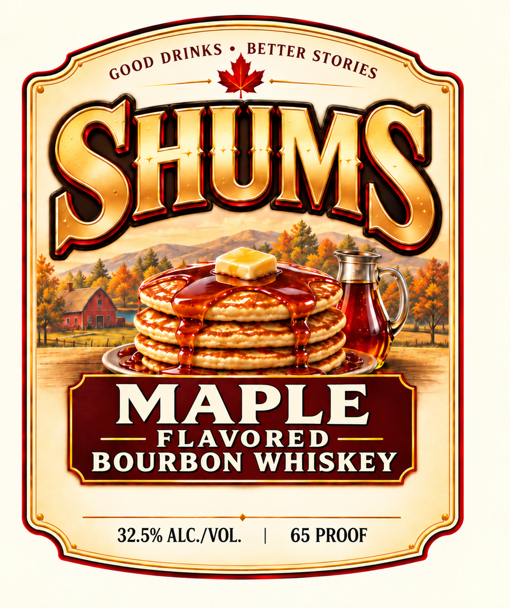

# TTB COLA Label Images - TTBID 26294001000342

**Brand Name:** SHUMS

**Issue Date:** 10/30/2026

**Origin Code:** 09

**Product Class/Type:** 149

**Source:** [TTB Public COLA Registry](https://ttbonline.gov/colasonline/viewColaDetails.do?action=publicFormDisplay&ttbid=26294001000342)

## Label Images

### Back Label

### Front Label

## Extracted Label Text

*Text extracted via OCR - may contain errors*

**Detected Proof:** 65

### Back Label

SHU
MAPLE
FLAVO RED
MAPLE FLAVORED
BOURBON WHISKEY
Shums Maple Flavored Bourbon Whiskey
blends the rich character of real bourbon
with natural maple flavor for a smooth;
easy-drinking finish. Crafted for
friends,
warm
nights, and unforgettable stories
Enjoy it chilled,
on the rocks
or as a shot.
PRODUCED AND
GOVERNMENT WARNING:
BOTTLED BY
(1) According
Surgeon General,
BECKMAN BROTHERS
wumeM
should not drink alcoholic
DISTILLERY
beverages during pregnancy because
NORWOOD, OHIO
ol the risk ol birlh delects
Consumption of alcoholic
beverages impairs your abilily
dnve
operate machinery;
and may cause hcalth
problems;
750 ML
32.5% ALC /VOL
'123456"789012
65 PROOF
ARTIFICIAL SWEETENER
D RTN
R E 5 P 0 NSIBLY_
good

### Front Label

BETTER
SHU
MAPLE
FLAVORED
BOURBON WHISKEY
32.5% ALC /VOL.
65 PROOF
DRINKS
STORIES
GOOD
