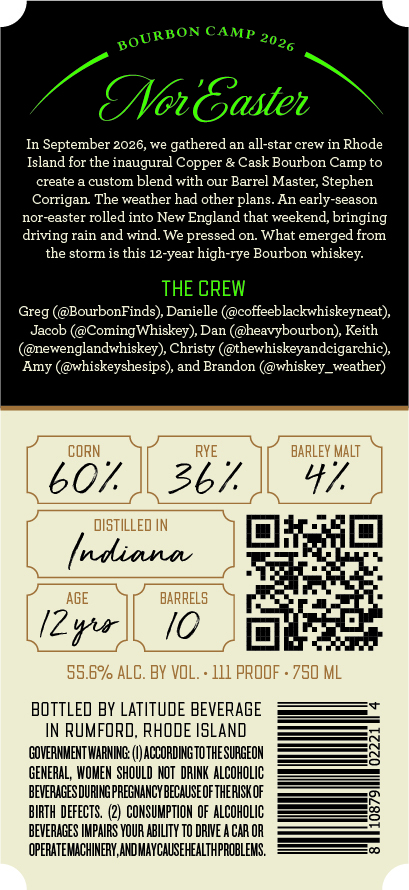
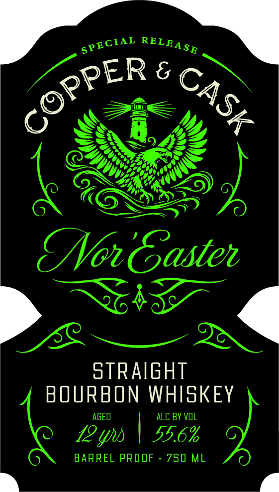
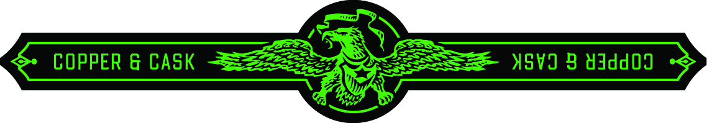

# TTB COLA Label Images - TTBID 26294001000391

**Brand Name:** COPPER & CASK

**Fanciful Name:** NOR'EASTER

**Issue Date:** 10/23/2026

**Origin Code:** 40

**Product Class/Type:** 101

**Source:** [TTB Public COLA Registry](https://ttbonline.gov/colasonline/viewColaDetails.do?action=publicFormDisplay&ttbid=26294001000391)

## Label Images

### Back Label

### Front Label

### Label 3

## Extracted Label Text

*Text extracted via OCR - may contain errors*

**Detected Proof:** 111

### Back Label

CAMP
TNoBasten
In September 2026,we gathered an all-star crew in Rhode
Island for the inaugural Copper & Cask Bourbon Camp to
create
custom blend with our Barrel Master; Stephen
Corrigan The weather had other plans. An early-season
nor-easter rolled into New
England that weekend, bringing
driving rain and wind
We pressed on. What emerged from
the storm is this 12-year high-rye Bourbon whiskey:
THE CREW
Greg (@BourbonFinds), Danielle (@coffeeblackwhiskeyneat);
Jacob (@ComingWhiskey) Dan (@heavybourbon), Keith
(@newenglandwhiskey), Christy (@thewhiskeyandcigarchic)
Amy (@whiskeyshesips), and Brandon (@whiskey_weather)
CORN
RYE
BARLEY Malt
607
367
47
distIlLed IN
(ndiana
AGE
BARRELS
[Z rir
I0
55.6%/ ALC. BY VOL:
111 PROOF . 750 ML
BOTTLED BY LATITUDE BEVERAGE
IN RuMFORD, RHODE ISLAND
GOVERNHENT WARNING:
ACCORDING TOTHESURGEON
GENERAL, WOHEN SHOULD NOT  DRINK ALCOHOLIC
BEVERAGESDURING PREGWANCY BECAUSEOF THEPISKOF
BIRTH DEFECTS ,  (2)  CONSUMPTIOM OF ALCOHOLIC
BEVERAGES IMPAIRS VOUR AbiLITY TO DRIE
CAR OR
OPERATEMACHINERY, AHDMAYCAUSEHEALTHPROBLEMS ,
BOURBON
2026

### Front Label

6
(oBasten
stRaight
BOURBON WHISKEY
AGED
ALC BY VOL
12 ys
55.6%
BARREL PROOF
750 ML
SPECIAL
RELE
COPPER
GASK

### Label 3

goon » =
és COPPER & CASK Sea SSS «SV B Nadd09 >
AN
