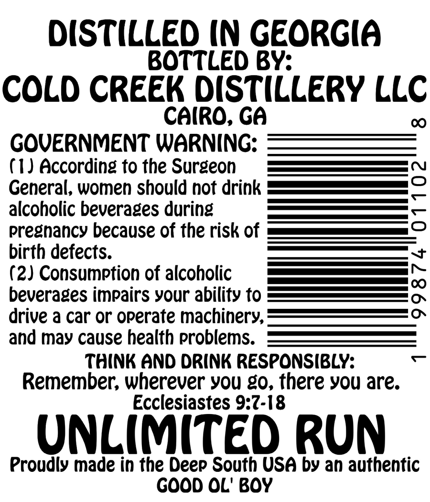
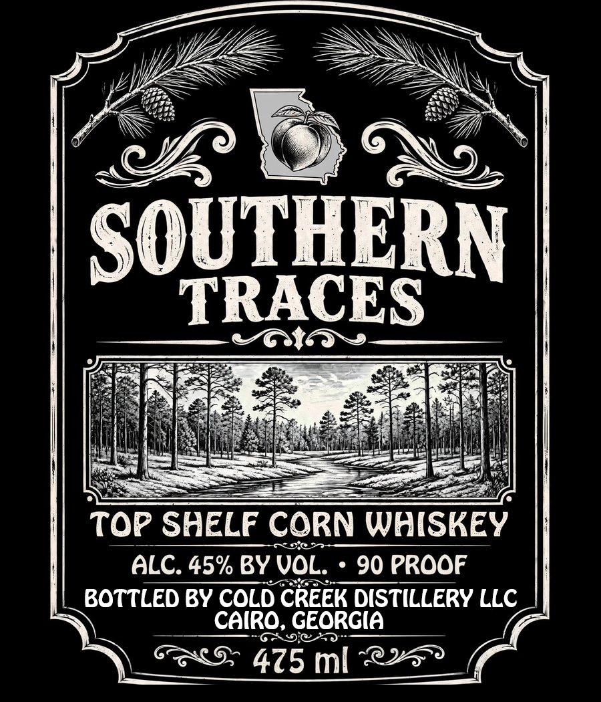

# TTB COLA Label Images - TTBID 26294001000432

**Brand Name:** SOUTHERN TRACES

**Fanciful Name:** TOP SHELF

**Issue Date:** 10/23/2026

**Origin Code:** 08

**Product Class/Type:** 143

**Source:** [TTB Public COLA Registry](https://ttbonline.gov/colasonline/viewColaDetails.do?action=publicFormDisplay&ttbid=26294001000432)

## Label Images

### Back Label

### Label 1

## Extracted Label Text

*Text extracted via OCR - may contain errors*

**Detected Proof:** 90

### Back Label

DiSTiLLeD IN GeoRGiA
BOTTLED BY:
COLD CREEK DISTILLERY LLC
Cairo; Ga
GOVERNMENT WARNING:
(1 J According to the Surgeon
General, women should not drink
8
alcoholic beverages during
pregnancy because of the risk of
birth defects.
(2) Consumption of alcoholic
beverages impairs your ability to
[
drive a car or operate machinery;
and may cause health problems:
think ANd DRINk RESPONSIBLY:
Remember; wherever you g0, there you are:
Ecclesiastes 9:7-18
UNLIMTED run
Proudly made in the Deep South USA by an authentic
GOOD OL' Boy

### Label 1

SOUTHERN
TRACES
Top SHELF CORN WHISKEY
FD@
ALC. 45% BY VOL.
90 PROOF
BOTTLED BY COLD CREEK DISTILLERY LLC
CaIRo, GEORGIA
475 ml
