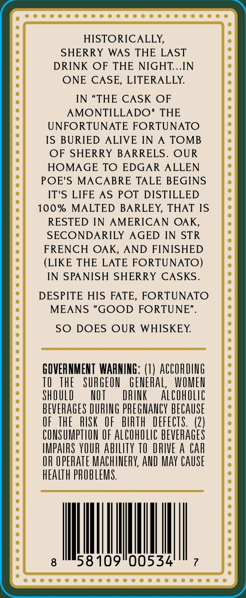
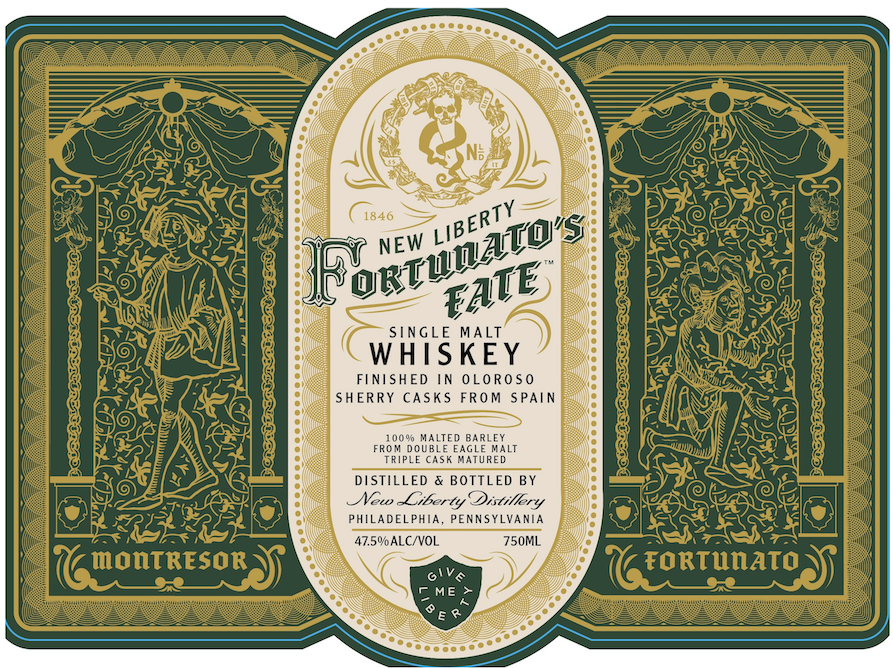
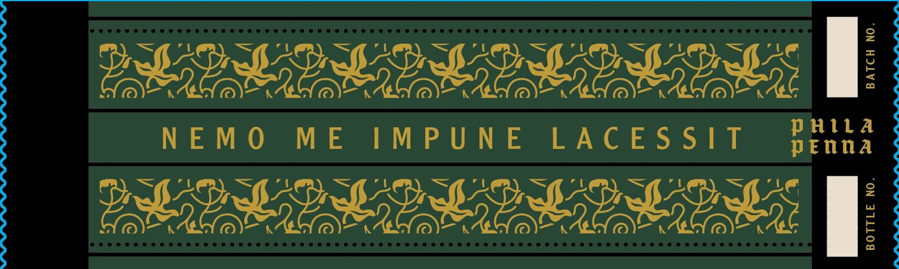

# TTB COLA Label Images - TTBID 26294001000662

**Brand Name:** FORTUNATO'S FATE

**Issue Date:** 11/09/2026

**Origin Code:** 39

**Product Class/Type:** 140

**Source:** [TTB Public COLA Registry](https://ttbonline.gov/colasonline/viewColaDetails.do?action=publicFormDisplay&ttbid=26294001000662)

## Label Images

### Back Label

### Front Label

### Label 3

## Extracted Label Text

*Text extracted via OCR - may contain errors*

### Back Label

HISTORICALLY,
SHERRY WAS THE LAST
DRINK OF THE NIGHT.IN
ONE CASE, LITERALLY
IN "THE CASK OF
AMONTILLADO'
THE
UNFORTUNATE FORTUNATO
IS BURIED ALIVE IN
TOMB
OF SHERRY BARRELS.
OUR
HOMAGE TO EDGAR ALLEN
POE'S
MACABRE TALE BEGINS
IT'S LIFE AS POT DISTILLED
100%
MALTED BARLEY, THAT IS
RESTED IN AMERICAN OAK,
SECONDARILY
AGED IN STR
FRENCH OAK, AND FINISHED
(LIKE THE LATE FORTUNATO)
IN SPA NISH SHERRY CASKS.
DESPITE HIS FATE, FORTUNATO
MEANS "GOOD FORTUNE" .
SO DOES OUR WHISKEY
GOVERNMENT  WAPNING: (1) ACCORdnG
TO  THE
SURGEON
GENERAL;
WOMEN
ShOuLD
NOT
DRINK
alcoholic
BEVERAGES DURLUG PREGHANCY BECAUSE
OF  THE
RISK OF   bIRTh DEFECTS.
(2)
COUSUMPTLOU OF alCohOLic BEVERAGES
IMPAIRS YOUR abilIty TO DRIVE A CAr
OR OPERATE MAChINERK, AND May CAUSe
hEaLTh PROBLEMS.
58109"00534

### Front Label

1846
NEW
SinGLE
MALT
WHISKEY
FINISHED
0LO Ros0
SHERRY CASKS FROM SpAIN
00% MALTED BARLEY
FRO # DoubLe EAGLE Kalt
TRIPLE Cask MATURED
DISTILLED & BOTTLED BY
New
Liber ty Distilkety
PHILADELPHIA
PENNSYLVANIA
47.SVALCNVOL
750ML
MontRESOR
FORTuOATO
6lV &
ME
LIBERTY
@RTWWATOS
EAE

### Label 3

NEMO ME IMPUNE LACESSIT

prenna

puira
