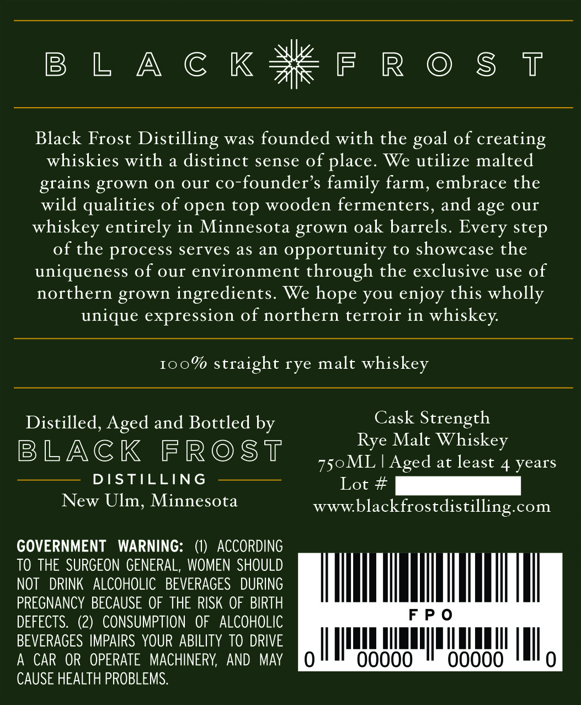
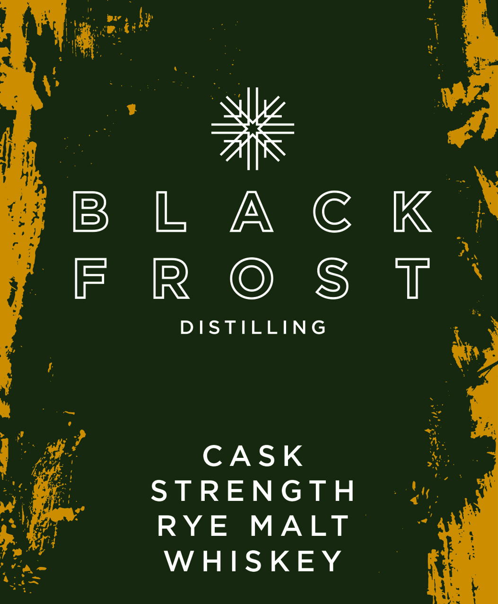
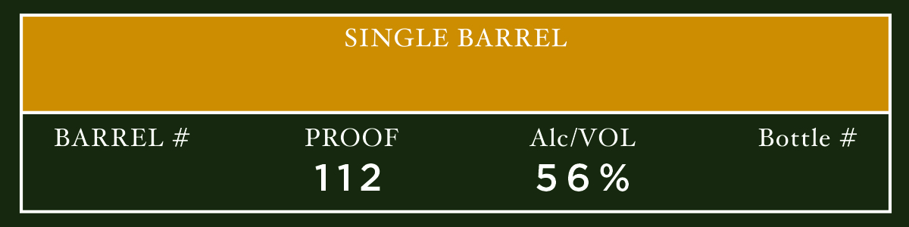

# TTB COLA Label Images - TTBID 26294001000677

**Brand Name:** BLACK FROST DISTILLING

**Issue Date:** 10/29/2026

**Origin Code:** 27

**Product Class/Type:** 118

**Source:** [TTB Public COLA Registry](https://ttbonline.gov/colasonline/viewColaDetails.do?action=publicFormDisplay&ttbid=26294001000677)

## Label Images

### Back Label

### Front Label

### Label 3

## Extracted Label Text

*Text extracted via OCR - may contain errors*

**Detected Age:** 4 Years

### Back Label

BLACK#FROST

Black Frost Distilling was founded with the goal of creating

whiskies with a distinct sense of place. We utilize malted

grains grown on our co-founder’s family farm, embrace the

wild qualities of open top wooden fermenters, and age our

whiskey entirely in Minnesota grown oak barrels. Every step

of the process serves as an opportunity to showcase the

uniqueness of our environment through the exclusive use of

northern grown ingredients. We hope you enjoy this wholly

unique expression of northern terroir in whiskey.

100% straight rye malt whiskey

Distilled, Aged and Bottled by

Cask Strength

Rye Malt Whiskey

BLACK FROST

750ML | Aged at least 4 years

DISTILLING

Lot #

New Ulm, Minnesota

www.blackfrostdistilling.com

GOVERNMENT WARNING: (1) ACCORDING

TO THE SURGEON GENERAL, WOMEN SHOULD

NOT DRINK ALCOHOLIC BEVERAGES DURING

PREGNANCY BECAUSE OF THE RISK OF BIRTH

PO

DEFECTS. (2) CONSUMPTION OF ALCOHOLIC

BEVERAGES IMPAIRS YOUR ABILITY TO DRIVE

A CAR OR OPERATE MACHINERY, AND MAY

alll

ui

aL

CAUSE HEALTH PROBLEMS.

### Front Label

CASK
STRENGTH
RYE MALT
WHISKEY

### Label 3

SINGLE BARREL
BARREL #
PROOF
AlcIVOL
Bottle #
112
5 6 %
