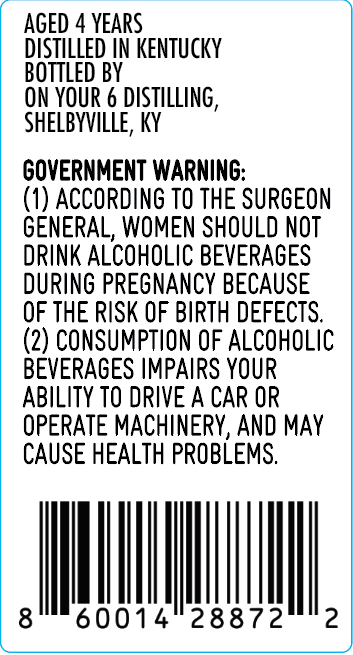
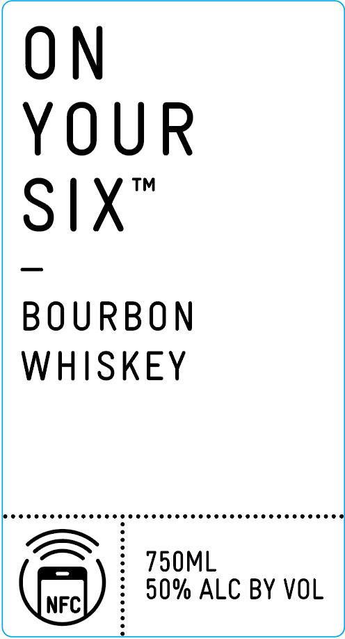

# TTB COLA Label Images - TTBID 26294001000678

**Brand Name:** ON YOUR SIX

**Issue Date:** 10/23/2026

**Origin Code:** 22

**Product Class/Type:** 141

**Source:** [TTB Public COLA Registry](https://ttbonline.gov/colasonline/viewColaDetails.do?action=publicFormDisplay&ttbid=26294001000678)

## Label Images

### Back Label

### Front Label

### Label 3

### Label 4

## Extracted Label Text

*Text extracted via OCR - may contain errors*

*2 image(s) excluded: text did not meet readability threshold*

**Detected Proof:** 100
**Detected Age:** 4 Years

### Back Label

AGED 4 YEARS
DLSTILLED IN KENTUCKY
BOTTLED BY
ON YOuR 6 distillIng ,
SHELBYVILLE, KY
GOVERNMENT WARNING:
(1) ACCORDING TO THE SURGEON
GENERAL, WOMEN SHOULD NOT
DRINK ALCOHOLIC BEVERAGES
DURING PREGNANCY BECAUSE
OF THE RISK OF BIRTH DEFECTS.
(2) CONSUMPTION OF ALCOHOLIC
BEVERAGES IMPAIRS YOUR
ABILITY TO DRIVE A CAR OR
OPERATE MACHINERV, AND MAY
CAUSE HEALTH PROBLEMS.
8
60014
28872
2

### Front Label

ON
YOUR
TM
Six
BOURBON
WHISKEY
750ML
50% ALC BY VOL
NFC
